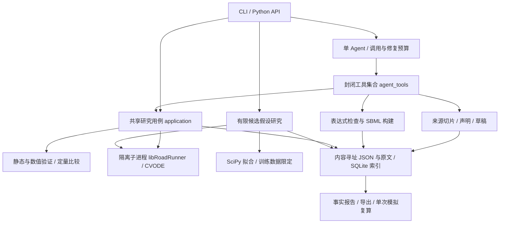

# v0.1 实际架构与使用

版本：0.1.0；交付日期：2026-10-15。本文件描述实际实现；原始提案描述设计意图。当前交付是可靠计算与受约束建模的研究原型，A 的通用文献提取和 B 的开放式机制发现仍需研究。

后续实现更新：受约束 B 研究现已通过冻结计划与 `run_study` 接入 Agent，见 [Agent 拟合与候选比较](agent-study-tool.md)。下文保留初版交付时的能力边界。

## 运行架构



模块位于 `src/biomodel_agent/`。`domain/` 管理不可变对象和严格 JSON 编解码，`expressions.py` 限制数学表达式，`modeling.py` 构建并验证 SBML，`simulation.py` 管理求解进程，`validation.py` 执行数值检查，`storage.py` / `evidence.py` 管理对象与来源，`application.py` 提供统一入口。`agent.py` / `agent_tools.py` / `llm.py` 管理产品 Agent；`fitting.py` / `hypotheses.py` 提供受约束 B；`reporting.py` / `bundles.py` 生成报告和研究包。

没有引入 Agent 框架、产品多 Agent、消息队列或微服务。开发监督脚本与产品运行没有依赖关系。

## 已实现的科学边界

| 环节 | 实际能力 | 当前限制 |
|---|---|---|
| 来源 | 保留 TXT/MD/PDF 原文、解析页、哈希、精确引用区间 | PDF 使用 pypdf；不含 OCR、可靠公式识别或任意版面解析 |
| 草稿 | 显式状态、参数、初值、反应、速率规则、派生量、依据映射 | 缺失值保留 null；表达式是受限语法 |
| 模型 | SBML 为唯一数学真源，libSBML 结构/语义检查 | 经过限制的 L2V3/L2V4/L3V1/L3V2 确定性 ODE 子集 |
| 生物量语义 | 反应模型区分 amount / concentration，按 SBML 处理固定体积 | 草稿的显式 rate rule 状态要求 quantity_kind=variable |
| 求解 | libRoadRunner CVODE，明确采样、初值、参数覆盖、分段外部输入 | 不支持 SBML 事件、延迟、代数规则、动态体积、fast、转换因子等 |
| 验证 | 有限数值、声明的非负性、容差加严重跑、冻结尺度轨迹比较 | 一般守恒检查为 not_run；未知单位不冒充已验证 |
| 拟合 | SciPy least_squares、多起点、明确边界和已知观测噪声，整体可超时终止 | rate_rule_fitting_v1 只支持参数形式状态和显式速率规则，不含一般反应 SBML 拟合 |
| 不确定性 | 局部 Jacobian 秩/条件、起点差异、边界和失败记录 | 无全局可辨识性证明、置信区间或完整后验传播 |
| 机制比较 | 三个合成适应候选模板，训练拟合与留出干预分离，保留不能区分的结果 | 人定义候选；无开放知识驱动机制发现 |
| Agent | 指定来源读取、草稿提交、模拟、结束、请求研究者；预算和审计 | B 拟合研究是独立 CLI/API，不是 Agent 自主操作的完整工具链 |
| 复现 | 冻结输入、结果、环境版本/代码哈希；单次模拟独立 replay | 不含拟合研究一键 replay、崩溃后 Agent 自动续跑或跨平台逐位保证 |

PDE 未来需要新增载荷契约、求解后端、边界/网格协议和验证，不是简单替换 ODE 求解器。当前 ModelArtifact 只执行 SBML ODE；通用来源、对象引用和研究包可复用，尚未实现通用 PDE IR。

## 科学状态与证据

执行是否成功、科学验证是否通过、来源是否支持结论是不同字段。检查保留 `pass / fail / unknown / not_run`，空检查集不算通过。

`passed_structured_reference` 仅表示冻结模型、协议、采样、尺度与阈值下的数值对照通过，不证明论文忠实性。严格复现遇到来源语义支持未知时返回 `not_verified`。引用检查能证明片段存在与数值出现，不能证明方程解释符合论文；尚无完整人审签署通过流程。

机制假设保存为系统猜想；合成案例边界与名义值是场景先验，不是测得的生物参数。数据明确标记 training / holdout，优化器只接受 training。局部诊断不等于置信区间，留出优势不等于真实机制证明。

Agent 不执行 shell、任意 Python 或不受限外部检索。引用必须来自来源白名单；工具由字面引用定位偏移，拒绝歧义引用、编造片段和不匹配数值。缺值或缺依据进入 `awaiting_input`；当前通过退出状态及审计传达，没有交互式续跑界面。

## 命令与产物

使用 `.venv/bin/python -m biomodel_agent`。完整参数见各子命令 `--help`。

| 命令 | 用途 |
|---|---|
| validate | 静态检查 SBML，严格模式未知检查不能算全通过 |
| run | SBML + 实验协议 + 可选观测/冻结参考，执行和保存运行 |
| agent | 指定来源、服务和模型，在调用预算内提取、建模、运行 |
| hypothesis | 对预定义适应候选进行训练拟合与留出比较 |
| report | 从保存事实生成 Markdown，含实际 SBML 方程/值和验证状态 |
| export | 导出根对象的已校验对象/原文依赖闭包，目标须为空目录 |
| replay | 从冻结 run 输入重新计算，不用 LLM/缓存，记录环境差异 |

实验 JSON 包含 `times`，可选 `initial_overrides`、`parameter_overrides`、`segments`。精确格式见 `domain/contracts.py` 及 `benchmarks/inputs/synthetic-birth-death-experiment.json`。参考文件可用基准的 `{times, values, scales, threshold}`。尺度和阈值应在计算前决定。

例如报告与复算（把 RUN_REF 替换为命令返回的哈希）：

```bash
.venv/bin/python -m biomodel_agent report RUN_REF \
  --store artifacts/my-evaluation/research-store --output artifacts/my-report.md
.venv/bin/python -m biomodel_agent export RUN_REF \
  --store artifacts/my-evaluation/research-store --output artifacts/my-bundle
.venv/bin/python -m biomodel_agent replay RUN_REF --store artifacts/my-bundle
```

`run/replay` 退出 1 表示执行或验证失败；严格模式 not_verified 返回 2。Agent completed 表示技术流程结束且无明确科学失败，可以仍为 not_verified，不能代替严格科学验收。hypothesis 工作流结束时还要检查比较是否 none_adequate / indistinguishable。

存储包含 `objects/<sha256>.json`、原文 blobs 和可重建 SQLite 索引。对象引用冻结版本，损坏/缺失会报错。缓存复用生成带 cached_from 的新记录；独立 replay 才是重跑。export 不打包密钥、环境或完整代码仓库；其他机器仍需代码与依赖。代码哈希可以发现变化，不能单独恢复旧代码。

## 后续优先级

先建立少量人工审核论文金标准，分别评分方程/参数/初值提取、依据映射、缺失信息拒绝与最终轨迹，并加入与通用编程助手及固定工作流的同预算对照。当前无优势证据，应先检验 Agent 是否值得保留。

接着补齐语义人审记录与任务恢复，扩展 B 候选提交/拟合工具、可辨识性与不确定性，再按真实案例需要引入事件、一般反应拟合或 PDE。扩大模型范围必须增加对应数值和科学基准。
