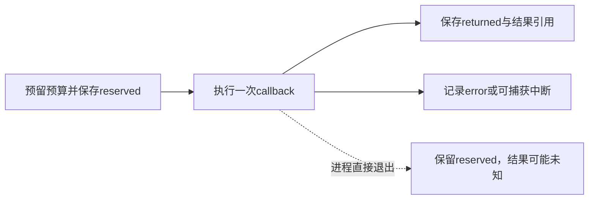

# 调用记录与预算持久化（T03a）

2026-10-19，已验收。任务来源：[优化任务队列](optimization-backlog.md)。本轮给单Agent增加持久调用边界，自动恢复、结果认领和并发所有者仍由T03b处理。

后续[T03b受控恢复](controlled-recovery.md)已实现并验收，新增序号、冻结初态、显式结果认领和本地所有者锁。下文保留T03a当轮事实与限制，不能把后续能力回写为历史验收。

## 问题与实现

原版本在第一次服务调用期间中断时，没有持久化的调用预留；服务返回后或模拟结果保存后中断，可能没有可恢复的Agent检查点，调用计数和结果关联随进程丢失。三个独立故障基线均复现了记录缺失。

新增invocations.InvocationJournal，Agent的实际服务、草稿提交、模拟、研究执行及读工具调用均经过它；动作权限、材料范围、科学门槛、模型消息和原有重试上限沿用原协议。流程控制finish/ask_researcher仍由原events和checkpoint记录。

| 记录 | 字段与含义 |
|---|---|
| agent_execution | version=1、唯一执行id、冻结task_ref、父run、继承call/run计数、原max_calls、max_runs=1；每次正常执行/恢复/替代分支有独立记录 |
| agent_invocation / reserved | 执行引用、稳定operation_id、操作名、调用/科学执行累计计数、类别、明确请求数据；在callback之前保存 |
| returned | callback已正常返回且摘要保存；与reserved共享operation_id；真实工具产物以refs关联；不表示科学验证通过 |
| error / interrupted | callback抛异常或可捕获中断；仅记录异常类型并重抛原异常；不能据此认定没有产生部分副作用 |

服务请求在调用前保留实际messages/context，服务返回在动作处理前保留原始JSON文本和整数usage。草稿记录保留校验摘要及实际模型/草稿/来源检查引用；模拟和研究记录保留真实结果引用。inspect_source只保留读参数及页面是否找到，不再重复保存整页。

reserved写入失败不执行callback；结果记录写入失败不重新执行callback。调用和计算次数只在预留成功后推进，错误/中断不退回；Agent通过finally同步其本地计数。记录的call_count/run_count是累计快照，不能把reserved和terminal里的数字相加当作费用。

## 引用、恢复与兼容

存储引用深度上限为64，所以日志没有跨操作的逐条链。reserved只引用执行记录；terminal只引用执行记录、本次reserved及实际结果。checkpoint和最终agent_run使用平坦invocation_refs并引用execution_ref，正常export带出日志闭包。21次脚本调用、82条记录验证了引用深度不随操作数量线性增长。

正常追问恢复继承既有计数，新建执行记录；替代分支保持不同执行id。新run/checkpoint的日志元数据不一致时，在写入研究者回复或调用模型之前拒绝恢复。兼容测试覆盖旧格式两边均无日志字段的暂停点：继续时只记录新增调用，不补造旧记录。已消费的科学次数不会因恢复重置。

类别respond/external_unknown、读工具/read_only、草稿/artifact_write、模拟或拟合/scientific_execution仅用于审计分类，不是自动重试授权。原有ProviderError重试仍逐次消费原调用预算，没有新增重试。

## 实施与实际结果

DSH完成记录模块和Agent主体集成。第一次连接在498.7秒后异常terminated，交付仍有遗漏；保存快照后，派发一次仅写agent.py的修订。修订已补大部分调用点，但最后一条编辑缺少新文本参数，权限策略返回wait/missing_edit，监督脚本停止；该不完整编辑请求未执行，没有修改权限策略。

Codex独立审查后做了局部修正：interrupted记录补异常类型；finish_session转发执行/调用引用；将nonlocal声明移到函数开头，并澄清列表变量名。未重写DSH主体，也未反复重派。原有测试文件没有修改。

验证记录：

- 旧版三个中断位置：3项失败；实际复现记录缺口。
- 记录模块初审：17项中16通过、1失败；首批完整交付：35项中23通过、12失败。
- 有界修订初审：38项中33通过、5失败，剩余问题同源于最终引用遗漏。
- 最终定向：233项通过，90.10秒；最终完整Python回归：849项通过，156.09秒，无失败、错误或跳过。
- 故障注入覆盖预留写失败、返回记录写失败、部分工具产物后中断、服务返回后动作处理前中断、重试预算、分支与兼容、恢复元数据拒绝及导出闭包。
- 子进程os._exit直接退出：服务入口只留下reserved；模拟结果保存后退出，留下实际结果引用；均没有伪造最终agent_run。
- 正常合成ODE用3次脚本动作完成，保留10条调用记录并全部导出；终点约0.670320283，科学状态仍not_verified。

源码快照、两批DSH交付与监督结果、Codex修正、原始失败、完整差异和实际存储样本见 [T03a验收记录](../artifacts/audit-t03a-invocations-20261019/acceptance.json)；具体中断与正常案例见 [fault-results.json](../artifacts/audit-t03a-invocations-20261019/fault-results.json)。

## 本轮的实际边界

- 尚无任意中断后的自动恢复入口；留下日志不等于能够自动续跑。进程直接退出可能只留下预留，外部请求是否收到及是否收费仍可能未知。
- returned只证明技术返回和记录完成；错误/中断也可能已有部分产物。没有exactly-once保证，没有自动认领结果或盲目重发。
- 预算按原执行分支及继承计数约束，不是跨分支全局费用锁或token/金额上限；本轮没有并发所有者锁。
- 正常最终run可导出日志；崩溃只有执行记录时，需按execution_ref人工检查存储中的相关记录。单独导出execution记录不会反向收集后续调用，T03b再提供收集与恢复控制。
- 测试覆盖进程退出和受控存储异常，不声称覆盖操作系统断电；日志增加I/O，未进行独立规模/延迟评价。
- 这是脚本动作、真实确定性工具与故障回归，不是模型自主科研能力提升。DSH开发通道与产品模型评价分开，本轮未发送c13/c18材料或重试此前被拒绝的在线回归。
