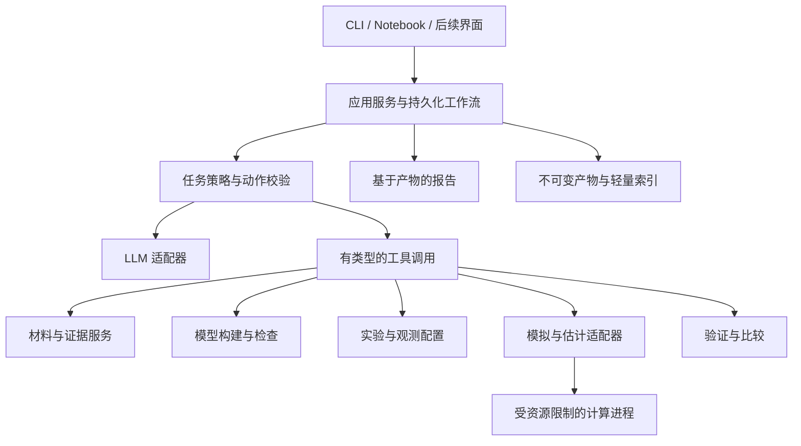

# 基础架构与关键决策

状态：原始 v0.1 设计提案；2026-10-14。已据此完成受约束实现，实际能力与差异见 [v0.1 实现说明](v0.1.md) 和 [验收记录](acceptance-v0.1.md)。本文保留设计意图，不作为已实现功能清单。

## 1. 产品定位与科学边界

BioModel Agent 是一个可审计的生物动力学建模系统。主要产物是可重跑的研究包，其中的数学模型、计算实验、依据和结论彼此关联。

首期用户是项目作者本人，场景为课程项目及后续个人科研。首期同时覆盖：

- A：从指定公开论文和补充材料重建确定性 ODE，复现预先定义的结果。
- B：从现象、数据和允许使用的机制知识构造少量候选 ODE，估计参数，比较留出预测，提出区分候选的实验建议。

科学结论必须区分：文献忠实性、数学一致性、数值可靠性、实验支持与适用范围。复现论文结果不证明论文机制正确；候选模型拟合成功不证明机制唯一或真实。无法区分候选、发现材料不足和定位失败原因都是有效产物。

首期不承诺任意 PDF 自动解析、开放式机制发现、通用 PDE、随机模型、延迟方程、复杂 DAE 或全自动实验验证。

## 2. 架构总览

采用模块化单体。一个本地应用进程管理任务与存储，数值任务在独立工作进程运行。首期无需微服务、分布式调度或消息中间件。

依赖方向：界面和 Agent 调用应用服务；应用服务调用领域逻辑与适配器接口；科学计算、LLM、存储的具体实现放在适配层。领域层不依赖任何 Agent 框架或模型供应商 SDK。工具入口和 CLI 必须调用同一应用服务，避免两套科学逻辑。

Agent 可以被替换为固定流程或人工调用；这三种入口都应执行同样的验证策略。

## 3. 模块边界

| 模块 | 责任与产物 | 边界 |
|---|---|---|
| materials | 保存原始材料，提取文本和位置，返回可定位片段 | 不把提取结果直接当作已验证科学事实 |
| evidence | 管理陈述、证据关系、冲突、假设与人工决定 | 不根据引用数量自动判定机制正确 |
| modeling | 接收结构化草案/修改，检查符号，构建版本化模型 | 不自动改变科学机制以匹配曲线 |
| experiments | 管理刺激、初始条件、观测映射、采样和数据分组 | 不把预处理藏在绘图代码里 |
| computation | 选择兼容后端，执行模拟、扫描和参数估计 | 不自行补齐未指定科学参数 |
| validation | 静态、数值、来源和目标结果检查 | 不允许 LLM 直接设置验证通过 |
| comparison | 按冻结的协议计算误差、留出表现及候选比较 | 不事后更换指标或查看留出集反复调参 |
| orchestration | 任务状态、预算、重试、断点恢复和人工输入 | 不拥有模型真值或私自修改科学产物 |
| reporting | 用证据、指标、诊断形成报告，LLM 可辅助解释 | 数字、引用、图表和通过状态必须来自产物 |
| storage | 不可变文件、引用校验、轻量索引及导出 | 缓存和索引不是科学事实的唯一副本 |

## 4. 模型表示：标准格式与研究元数据分层

### 4.1 推荐方案

使用模型无关的 `ModelArtifact` 外壳，包含类型、格式、版本、来源、能力需求和负载引用。首期负载为 SBML。每个模型版本只有一份权威可执行负载。

证据、待定假设、实验、运行设置不硬塞进 SBML；它们通过版本化对象与 SBML 元素标识建立链接。选定的生物语义注释可以导出到 SBML，但项目元数据仍保留独立副本。

LLM 提交 `ModelDraft` 或 `ModelPatch`，由构建器转换成 SBML。草案是提议和溯源记录，不是与 SBML 并列可独立修改的执行真值。模型修改以父版本为基础生成新版本，并同步产生证据映射和差异记录。

模型展示的方程从执行负载生成；原文方程另行保留。必须能比较“原文表达—提取草案—最终执行表达”。

### 4.2 替代方案及代价

- 自建通用数学中间表示：便于直接 ODE/PDE 和符号变换，但要承担编译、作用域、量纲、事件和转换语义的长期维护。首期不采用。
- 任意 Python 作为模型真值：表达自由，但难以静态检查与准确归因；首期不开放 Agent 任意代码执行。未来如需自定义后端，以受控插件形式接入。
- SBML 包揽全部知识：科学假设与审查过程难以完整表达，因此不采用。

此方案保留一种简短的草案数据结构，但不建设新的通用建模语言，也不实现双向自由编辑的多个模型真值。

### 4.3 首期支持配置

提出 `ode_core_v1` 能力配置，最终清单由首批模型审查和适配器测试冻结：

- 有限个状态、显式参数和初始值；单个固定体积区室。
- 反应动力学形式，或用 rate rule 表达的显式 ODE；同一状态不能同时有冲突的演化定义。
- 常数、时间、已声明符号与白名单数学运算；允许 Hill 型表达，但其定义域和单位需要检查。
- 无环代数赋值可作为派生量，需明确依赖顺序；不支持隐式代数约束。
- 参数作用域、物质量/浓度、区室体积换算、边界物种和恒定状态均需显式解释，不能依赖含混默认值。
- 首期不支持通用 SBML events、delay、动态区室体积及模型要求但后端不支持的包。
- 首期刺激可采用实验协议中的分段常值外部输入；在段边界准确停止、修改输入并继续积分，保留状态连续性。该功能不等于通用事件支持。

语义需求在执行前扫描。不支持的语义返回 `unsupported`；不能删除它再运行。原始导入文件保持不变。标准格式转换、参数展开或无量纲变换必须保存转换记录并核验语义。

SBML 规范支持的范围大于本项目声明支持的范围。底层库能读取一个文件不等于本项目能可靠执行它。[SBML 规范](https://sbml.org/documents/specifications/)

## 5. 科学依据与不确定性

把“陈述类型”“证据关系”“审查状态”分开记录：

- 陈述类型：实验观察、论文假设、数学定义、模型推断、系统候选猜想、人工约定。
- 证据关系：原文如此表述、支持、反对、由计算推导；每条关系包含来源与适用条件。
- 审查状态：待核查、已核对来源、存在争议、已由研究者接受用于某次分析。

已核对来源仅表示忠实转述。人工接受用于分析不代表成为生物学事实。假设不会因拟合改善而自动升级为事实。

不确定性分开表示：材料歧义、测量噪声、参数不确定性、模型结构不确定性和数值误差。缺失参数不是一个隐含均匀分布；参数边界不是置信区间；LLM 自报信心不作为统计概率。

有合法无量纲化依据的模型可以使用无量纲变量；单位未知必须记录为 unknown，不能默认 dimensionless。守恒与非负性检查仅适用于模型宣称满足的性质。例如开放系统不默认总量守恒，电势等有符号变量不默认非负。

## 6. A 与 B 共享核心，采用不同策略

### A：文献复现

1. 定义目标结果与允许使用的材料。
2. 提取模型、实验协议和观测映射，建立逐项依据。
3. 检查缺失、冲突及不支持语义。
4. 构建模型并进行静态检查。
5. 执行模拟，做数值诊断。
6. 按冻结指标比较参考结果。
7. 导出来源映射、计算结果、未解决问题和结论。

严格复现不允许靠拟合目标曲线补论文缺失参数。若开展补参数探索、重校准或纠错，建立独立分支，标记 `reconstruction_with_assumptions`、`recalibration` 或 `corrected_variant`，不能报告为严格复现。

论文原模型含问题时可保留原始数学表达用于诊断。无法通过硬性数学检查时不执行；科学或单位问题尚未解决但可计算时，可按探索策略运行并保留警告，不能据此获得“数学验证通过”或“严格复现通过”。

### B：受约束新模型构建

1. 给定现象、实验数据、允许使用的机制知识与候选规模预算。
2. 提出少量可检验的机制及必要假设，包含简单基线。
3. 创建候选模型；每个新增方程项关联假设。
4. 使用一致的观测映射及可比的噪声假设进行参数估计。
5. 检查拟合诊断、可辨识性线索和预测稳定性。
6. 按条件或干预留出数据，比较预测和复杂度。
7. 报告候选相容性、不能区分的部分、建议的区分实验与适用范围。

B 可以从已有模型分支，也可以从空草案构建。执行入口不要求存在父模型，避免把 B 永久限制为修改 A 的模型。

候选比较不是强制选冠军；允许全部不合格或多个不可区分。实验建议必须说明“在当前候选、参数不确定性和噪声假设下预计可区分”，不能直接宣称现实实验一定有效。

## 7. 数值求解与参数估计

### 7.1 计算后端

首选 libSBML 做读写和结构检查，libRoadRunner 做首期 SBML 模拟；Tellurium/Antimony 可用于人工整理与模型查看，不强制成为所有层的依赖。SciPy 用于选定显式 ODE 的独立参考核验与初期有限优化。具体安装组合通过小型兼容性验证后锁定。

libSBML 提供检查能力，但合法 SBML 未必有完整单位信息，无法检查应返回 `unknown`。[libSBML](https://sbml.org/software/libsbml/)、[SBML 单位说明](https://sbml.org/documents/faq/)

未来在估计规模增加时评估 AMICI/pyPESTO；通过适配器接入，避免把特定求解器类型传入领域层。模拟协议借鉴 SED-ML，估计问题借鉴 PEtab；首期声明自有受限契约，不宣称已经完整兼容或无损导出这些标准。[SED-ML](https://sed-ml.org/)、[PEtab](https://petab.readthedocs.io/en/latest/)

### 7.2 求解策略

- 根据能力与问题特征选择算法；记录后端、算法、容限、最大步数和超时。
- 输出采样时刻和求解器内部步长分开。增加绘图点数不等于提高积分精度。
- 绝对容限按状态尺度配置；若后端仅支持标量容限，明确该限制，采用有记录的尺度化或保守设置并核验，不能伪称已应用逐变量容限。
- 成功退出还需检查非有限数、适用的约束、关键输出和容限收紧后的稳定性。
- 负值不能无声裁剪；区分微小数值偏差、模型结构问题和非法初始条件。
- 稳态需检查残差和观测时间窗；双稳态需考虑不同初始条件及守恒约束，不能只调用一次稳态求解就判定。
- 对振荡使用预先规定的暂态剔除和周期判定；瞬态衰减振荡不能自动标为极限环。
- 独立后端核验应避免同一转录错误生成两个“独立”答案；参考构建需独立审查。算法间一致仍不是正确性的证明。

### 7.3 估计与不确定性

初期只估计少量参数，显式给定边界、尺度、初值策略和似然/残差定义。使用多起点，保存失败与所有有效终点。拟合需要输入观测模型，而不直接把状态与任意实验读数比较。

在适用、可计算的情况下做结构可辨识性分析；无法分析时记录 unknown，不以局部灵敏度矩阵满秩冒充全局证明。先做灵敏度、参数相关性和局部不确定性诊断；profile likelihood 或 bootstrap 按资源选用，标明各自假设。未执行不确定性分析就明确报告，不能只画一条拟合线暗示参数已确定。

模型比较优先留出干预条件。似然准则仅在其假设和可比条件满足时使用；增加自由参数的训练拟合改善不是机制证据。反复查看留出结果后调整模型，会使其失去独立验证地位。

## 8. Agent 架构与人工介入

产品内部使用一个逻辑 Agent。它读取任务摘要和相关产物，通过有类型的动作请求工具。提取、诊断、解释可以有不同提示模板，但没有各自独立的自主角色状态。

动作经过两类检查：确定性校验器检查输入和数值事实；应用策略检查该动作是否符合任务模式、证据状态与预算。LLM 无权覆盖检查结果。

| 动作 | 默认策略 |
|---|---|
| 查找片段、重新提取、运行已有有效模型 | 自动 |
| 有原文直接依据的转录修正 | 新版本自动处理，记录依据并重验 |
| 收紧容限、兼容算法重试 | 在预算内自动，保存完整配置 |
| 对 B 在预先允许的机制空间提出候选 | 自动生成假设分支，不能升级为事实 |
| A 补缺失参数、解决互相矛盾的科学定义 | 请求研究者决定，或输出未解决问题 |
| 超出 B 预定范围的新假设 | 请求研究者决定或保留未采用提案 |
| 修改比较指标、使用留出数据重新拟合 | 创建明确的新研究协议，保留旧结果与数据使用记录 |

不因每次模拟请求确认。已有研究者授权覆盖的候选范围可以持续自动探索。人类决定绑定具体问题、模型版本和使用范围，不能变成无限期通行证。

重试预算建议初值：每次诊断最多 3 次有不同依据的技术恢复；B 最多 3 个候选；每项数值操作另有超时；LLM 调用数与费用预算由运行配置决定。重复同样动作且无新信息时停止，不能无限自我修复。

材料文本作为数据读取，不能被其内嵌指令改变工具权限。首期工具不提供任意 shell/Python 执行；计算工作进程只加载受支持的模型和受控后端，限制文件访问与资源。不需要为此先建设完整多租户平台。

## 9. 运行与存储

本地文件保存原始材料与不可变产物，SQLite 保存索引、任务状态和引用。数值数据首期使用带列元数据的表格格式或 NPZ；数据库不直接承载大矩阵。未来多维空间数据可增加适合坐标与场的数据格式。

运行前解析全部对象版本并生成输入清单，避免执行中读取 latest。运行后保存配置、环境、日志、输出及检查结果。缓存命中也产生可追溯运行记录。恢复中断任务不能覆盖已存在结果。

“重跑计算”使用冻结模型和协议，不重新调用 LLM。“重新进行模型提取”是新的 Agent 运行，不承诺文本或决策逐次相同。

## 10. 扩展策略与暂缓事项

- PDE：增加新的模型负载、后端、空间实验和网格收敛验证器，复用证据、运行、比较和报告协议。仅预留边界，不声称现有 ODE 验证足够。
- 多 Agent：只有公平对照显示在质量或成本上有稳定收益时引入；共享同一产物仓库与权限，不以投票取代验证。
- 知识图谱：跨论文查询成为实际瓶颈后再升级存储。
- Web UI：CLI/Notebook 闭环完成后添加，界面不拥有额外科学逻辑。
- GPU：计算或本地推理实测成为瓶颈时再评估；当前不依赖。
- 微服务与集群：本地进程和任务预算不能满足实际需求时再考虑。

架构可扩展性通过明确接口、不可变产物和兼容性测试实现。首期不实现没有真实使用场景的插件市场或通用分布式框架。
