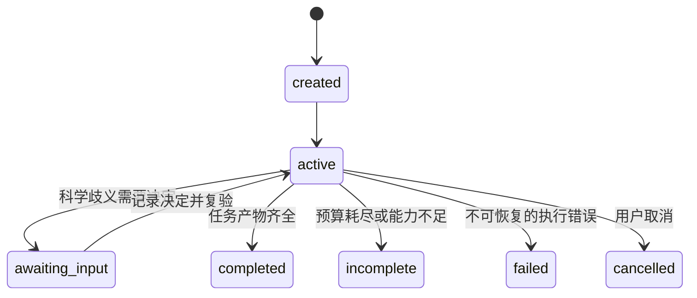

# 数据契约与执行协议

状态：原始 v0.1 契约提案；2026-10-14。本文给出逻辑设计与示意签名。实际 API 以 src/biomodel_agent/domain/ 为准，实现范围及尚未落实项见 [v0.1 实现说明](v0.1.md)，不将下文所有元数据字段视为已实现。

## 1. 通用对象约定

所有持久化科学对象具有：`schema_version`、稳定对象标识、不可变版本标识、创建时间、创建者、父版本或派生关系，以及载荷校验值。

- 引用必须包含对象版本，执行输入不能引用 latest。
- 数值字段不能用空字符串代表缺失；缺失使用显式状态和 null，不自动填零。
- 数值有单位或明确的 dimensionless/unknown 标记；区分数学量、观测尺度和显示格式。
- 时间点、列名、符号名和样本标识必须唯一或遵守明确的重复规则。
- 对外部文件保存来源、原始文件哈希和定位；文件变化后不能复用旧来源定位。
- 所有派生对象包含实际依赖的版本引用，而不仅是“来自某个项目”。

为避免一开始建设复杂通用事件系统，可以用不同对象表或文件保存这些字段，但字段语义和引用校验应统一。

## 2. 主要对象

| 对象 | 关键字段 | 必须保证 |
|---|---|---|
| ResearchTask | mode、目标陈述、输入引用、能力范围、比较协议、预算 | mode 明确为 reproduction 或 hypothesis；不能从结果猜测目标 |
| SourceDocument | 文件、哈希、URL/DOI、获取时间、解析器版本 | 原始文件不可覆盖 |
| SourceSpan | 文档版本、页码/公式号/表格单元格/区域、摘录引用 | 位置可回到具体源文件，OCR 推断有标记 |
| Claim | 陈述、类型、实体、适用条件、审查状态 | 自报 confidence 不作为科学证据 |
| EvidenceLink | claim、source/run、关系、范围、核查记录 | “论文如此写”与“实验支持”使用不同关系 |
| Hypothesis | 机制陈述、依据、假设、适用条件、候选预测 | 允许无直接支持的探索，但显式标记 |
| ModelDraft | 反应或 ODE、符号、参数、初值、来源映射、未解决问题 | 不可直接执行；允许部分缺失 |
| ModelPatch | base_model_ref、操作、理由、来源/假设、预期影响 | 有父版本前置条件；冲突时不能静默覆盖 |
| ModelArtifact | kind、format、payload、capability_requirements、element_map | 一份权威可执行负载；不支持语义不能被删除 |
| ParameterSet | 模型版本、符号映射、取值、单位、角色、来源 | 区分 reported、fixed_assumption、estimated、unknown |
| ExperimentSpec | 模型版本、条件、初值覆盖、预平衡、刺激段、采样时刻 | 实验条件与求解器设置分离 |
| ObservationSpec | 模型版本、observable 表达式、单位、缩放、噪声 | 所有拟合与比较使用明确的状态到测量映射 |
| Dataset | 原始数据、单位、条件、时间、重复、预处理与分组 | 原始值保留；训练/验证/测试角色可追溯 |
| SimulationRequest | model、parameters、experiment、observations、solver | 引用完整且被冻结，执行前能力匹配 |
| EstimationProblem | 数据、参数边界/变换、噪声/目标函数、多起点策略 | 不把缺失参数的临时猜测当作论文取值 |
| RunRecord | 输入清单、后端版本、状态、环境、输出、日志、检查 | 后端退出状态与科学结论分开 |
| ValidationReport | scope、规则版本、每项状态、严重度、证据 | 记录未检查和不能判断，不能默认为 pass |
| ComparisonProtocol | 参考对象、指标、时间窗、对齐、阈值、数据分组 | 比较前冻结，事后改变产生新版本 |
| ComparisonResult | 协议、候选、运行、指标、限制、数据使用记录 | 指标名称必须带定义和版本 |
| DecisionRecord | 问题、选项、选择、理由、依据、作者、适用范围 | 科学人工决定不能由 Agent 冒签 |
| ResearchReport | 结论、证据、运行、图表、问题、复现入口 | 指标和通过状态由工具结果填充 |

`Hypothesis` 可引用多个 Claim。一个 ModelArtifact 可绑定多个假设；同一机制也可对应多个数学实现。别用一对一表结构限制未来机制比较。

## 3. 来源与执行表达的绑定

`element_map` 至少覆盖：状态定义、反应/ODE 项、参数、初始条件和必要的单位/换算。

定位方式为“模型版本 + 稳定元素 ID + 语义字段路径”。例如 `reaction:J1 / kinetic_law`、`parameter:k_deg / value`。不要单独依赖易受格式化影响的 XML 行号。实验中的初值覆盖与刺激绑定 ExperimentSpec 的字段路径。

一条来源映射可为：

```json
{
  "target": "parameter:k_deg/value",
  "value_origin": "reported",
  "evidence_refs": ["evidence_17@v1"],
  "transformation_refs": ["conversion_2@v1"],
  "review_status": "source_checked"
}
```

此例只示意绑定，不是完整持久化对象。`source_checked` 表示核对了原文位置，不表示参数适用于所有生物条件。

单位换算和表达式重写必须记录输入、输出及理由。合法的等价变换可能改变字面表达，因此不能只用字符串相等评估方程提取；应结合符号结构、单位和独立参考行为。

## 4. 模型构建协议

### 4.1 结构化草案

草案表达式采用可解析的受限表达语言，白名单包含所需的数学函数、运算和符号。禁止 eval、导入、文件访问和网络操作。解析器输出数学语法树，交给 libSBML 构建 MathML；它不是新的通用数学编译平台。

草案至少明确：

- 状态：ID、含义、amount/concentration/其他数学量、单位、初始条件。
- 参数：ID、作用域、单位、数值或缺失状态、来源。
- 结构：反应计量与速率，或明确的状态导数；派生量依赖。
- 区室：固定体积及单位；无量纲情况提供约定依据。
- 适用性质：例如某个总量守恒、某些状态非负；不能无差别强加所有性质。
- 未解决事项：影响执行或影响科学解释分别标记。

生成为 ModelArtifact 前必须完成：符号和作用域检查、重复/冲突演化定义检查、后端能力匹配，以及构建后反读核对。图表和报告中的方程来自反读后的模型。

### 4.2 修改与分支

允许的修改类别包括：修复有依据的转录错误、修改实验条件、修改参数集、提出新机制和数学重参数化。不同类别进入不同的版本或对象。

- 修改刺激优先创建 ExperimentSpec，不重写基础模型。
- 拟合输出创建 ParameterSet，不覆盖论文原参数。
- 修改动力学结构创建新的 ModelArtifact，并绑定假设与父版本。
- 修改来源审查记录也创建新记录；若导致执行模型变化，再产生模型版本。

任何修改都重新评估受影响的验证。旧检查不能因为模型名字没变就复用。

## 5. 实验、观测与数据

### 5.1 实验语义

ExperimentSpec 描述输入与输出的科学含义，不包含自动挑选的求解器细节。

初值优先级明确为：实验显式覆盖 > 本次 ParameterSet 中已声明为初值的取值 > 模型固定默认值。覆盖需可追溯，并在 resolved input manifest 中列出最终有效值。不同层不能同时悄悄提供互相冲突的定义。

预平衡若被请求，要有达到稳态的判据、最长时间和失败处理；未达到预平衡就不能把结果当作协议完成。

分段输入明确左右端点、切换时刻及采样值定义，切换时刻若有观测需规定使用哪一侧的输入。状态重置不属于首期分段输入能力；需要重置则声明并新增专门能力。

### 5.2 观测映射

观察值可以为状态、状态组合、缩放或归一化后的表达式。拟合缩放因子和噪声参数算作自由参数，也需要边界及版本。

数据预处理必须保存转换协议；归一化若使用训练数据估计统计量，不能从测试数据取值再反用于训练。重复测量、缺失值、删失和检测限需要显式状态；首期不支持的情况返回 unsupported，不能静默删行。

首期只支持明确的有限噪声模型，例如已知标准差的加性高斯噪声。默认无权从图片误差条推断其究竟是 SD、SEM 还是置信区间。噪声信息未知时可以做指定残差度量的探索拟合，但不能伪称严谨似然分析。

## 6. 服务与工具接口

所有接口返回统一外壳：`status`、`artifact_refs`、`diagnostics`、`next_allowed_actions`、`usage`。大数组存为产物，不塞进 LLM 上下文。

| 逻辑接口 | 主要输入 | 产物 |
|---|---|---|
| ingest_material | 文件与来源元数据 | SourceDocument、解析产物 |
| retrieve_evidence | 任务允许的材料、查询/位置 | SourceSpan 引用 |
| extract_model_draft | 片段引用、目标、支持配置 | ModelDraft、候选 Claim、问题 |
| build_model | 草案或补丁、来源映射 | ModelArtifact、构建诊断 |
| validate_model | 模型、参数、实验、规则集 | ValidationReport |
| resolve_simulation | 版本化配置、执行策略 | resolved input manifest 或问题 |
| simulate | 已验证的请求与预算 | RunRecord、原始数值数据 |
| estimate_parameters | EstimationProblem 与预算 | 多起点结果、ParameterSet、诊断 |
| compare_results | ComparisonProtocol、运行与参考 | ComparisonResult |
| record_decision | 问题、选择、理由、作者和范围 | DecisionRecord |
| render_report | 版本化产物引用与模板 | 报告、图表、产物目录 |

工具不能通过 LLM 传入的自由文本 path 访问任意文件。使用仓库解析的产物引用；来源文件中的命令不进入执行接口。

估计任务可以使用大量内部模拟；这些子运行沿用同一计算与诊断内核。生产环境允许用批次记录压缩存储，但必须保留各起点的状态、目标值、配置和可复现种子，不能抹掉失败。

后端最小接口为：查询能力、检查兼容性、准备模型、执行请求、返回标准结果。灵敏度和估计是可选能力；不能要求每个未来 PDE 后端都实现所有 ODE 优化功能。

## 7. 任务与运行状态

### 7.1 任务状态



任务 `completed` 只表示研究任务有完整的可审计产物。其科学结果可以是复现未达标、材料不足或多个机制不可区分。

如任务定义允许“整理完所有可确定信息并报告缺失”即交付，那么报告明确材料不足可以 completed；如果任务要求完成模拟而输入仍缺失，则是 awaiting_input 或 incomplete。Task 中事先声明交付条件，避免任意把失败包装成完成。

### 7.2 单次数值运行状态

`queued → running → succeeded / failed / timed_out / cancelled / interrupted`。

`succeeded` 表示后端按请求执行结束并返回结构合法的数据，不等于验证通过。数值验证和论文比较使用独立产物。

崩溃恢复后遗留的 running 标记为 interrupted；新尝试生成新 RunRecord 并关联原尝试。未完整写出的产物不得作为成功缓存使用。

### 7.3 验证结论

每项检查返回 `pass / fail / unknown / not_applicable / not_run`，另有 `blocking / warning / informational` 严重度。规则适用条件、阈值及证据都在报告中。

例如：

| 问题 | 默认执行策略 | 报告影响 |
|---|---|---|
| 未定义符号、初值缺失、要求不支持的语义 | 阻止执行 | 不能生成正常成功报告 |
| 不可核查的单位 | 可在显式探索策略下执行 | 数学验证为 unknown；不能宣称量纲已通过 |
| 文献来源互相矛盾 | 暂停受影响的严格复现 | 要求决定或报告未解决 |
| 后端成功但输出 NaN | 数值验证失败 | 不能进入普通定量成功比较 |
| 可计算但参考结果不匹配 | 允许诊断分析 | 复现不通过 |
| 参数不可辨识 | 不必阻止所有预测 | 禁止声称唯一参数/机制，标注可支持的预测范围 |

最终报告展示多个维度，不压缩为一个“科学正确性得分”。

## 8. 复现、缓存与审计

### 8.1 输入清单

每次执行保存：模型负载校验值、元数据版本、有效参数、初值、实验、观测、求解设置、后端版本、代码版本、环境锁文件、平台信息、随机源和预算。代码版本在未使用 Git 时以源码快照校验值等方式记录，不能伪造提交号。

原始文件按精确字节哈希。结构化配置采用明确版本的规范化序列化规则计算哈希。不要把数学“等价”当作内容哈希相同；等价需要单独证明记录。

缓存键涵盖所有影响数值结果的配置、代码和环境标识。来源元数据变化即使不影响数值缓存，也必须生成新的研究谱系引用。使用缓存的运行记录注明原运行；不能伪装成独立复算。

### 8.2 写入与恢复

产物先写临时路径，校验完成后原子提交；数据库事务记录完成状态和引用。由于文件系统与 SQLite 不能简单构成同一事务，启动恢复需要识别未提交临时文件和已落盘未索引产物。按运行 ID 幂等恢复，不覆盖旧产物。

首期可以单写入者运行，数值工作进程通过应用层提交结果，避免过早引入复杂并发冲突。

### 8.3 Agent 审计

保存实际输入消息/模板版本、上下文产物引用、模型标识、采样配置、结构化响应、工具请求、工具结果引用与资源用量。API 密钥和其他凭证不写日志。

保存简洁的行动理由和证据，不要求记录模型内部隐藏推理。日志用于复查行为，不保证基础模型逐次输出完全一致。

### 8.4 报告不变量

- 每个数值、图表、引用和结论具有产物或证据引用。
- “未运行”“不支持”“未通过”显示为各自状态，不能变为零值或省略。
- 区分作者参数、研究者补充参数、拟合参数。
- 保存原始失败和后续修复之间的差异。
- 显示人工介入次数及实质修改；统计基准时包括整理与修正的工作量。
- 复现入口使用冻结输入，不依赖外部网站实时内容或重新调用 LLM。

## 9. 版本演进与兼容性

契约 schema 与模型格式版本分开管理。改变字段语义需要 schema 升级；迁移产生新产物并记录源版本，不能原地重写原始研究包。

适配器声明支持的输入格式和能力配置，并使用对应测试验证。导入或导出丢失语义时返回明确失败或损失报告，不能标为无损转换。

未来的 PDE 模型只需遵守通用对象引用、实验、运行和验证协议；其模型负载、空间数据与网格检查使用专门契约。不会把所有模型强迫改写为首期 ODE 草案。
