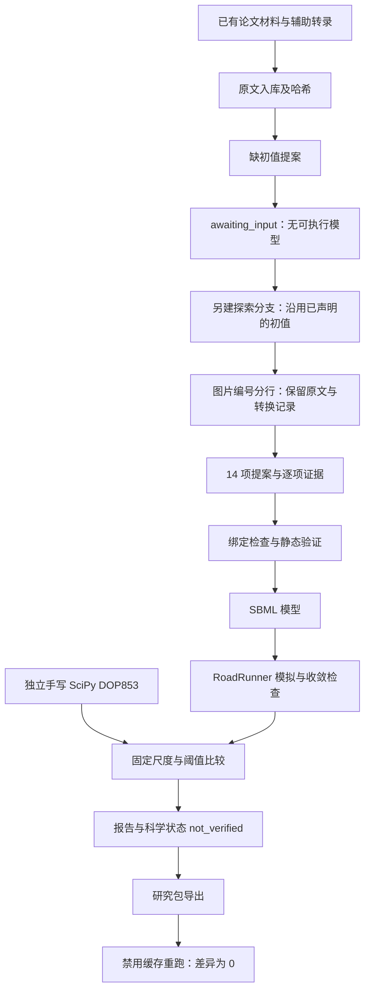
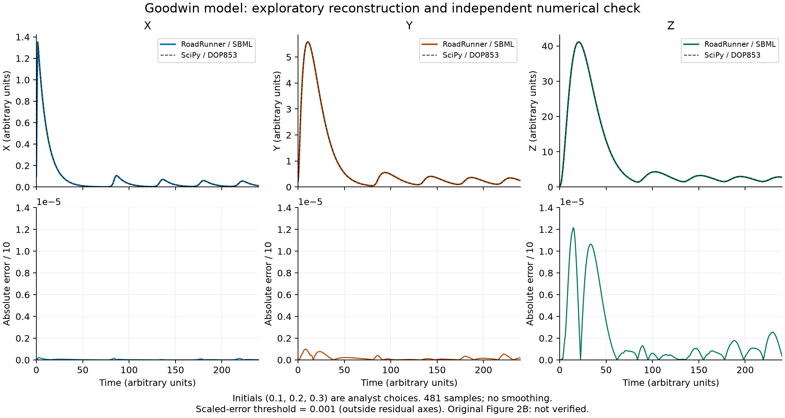
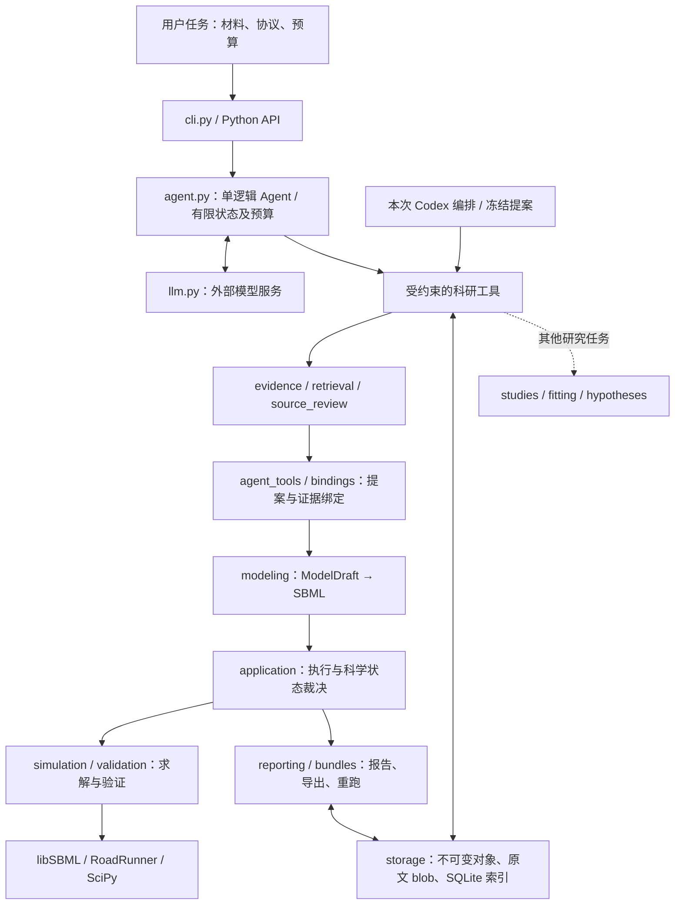

# Goodwin 文献模型：完整工具流程演示

本轮实际执行了材料入库、缺失信息阻断、证据绑定、SBML 构建、模拟、独立数值对照、研究包导出和重跑。时间：2026-10-21（Asia/Shanghai）。

**数值对照通过，严格论文复现仍为 `not_verified`。** 本轮由 Codex 整理提案并编排工具；产品内部 `agent.run_agent` 与独立 LLM API 未调用。重跑脚本使用已冻结提案，不是通用文献提取器。

## 任务与结果

论文：Gonze & Abou-Jaoudé (2013), *The Goodwin Model: Behind the Hill Function*，DOI `10.1371/journal.pone.0069573`。使用仓库已保存的出版社 XML 与辅助转录，范围为方程 (1)–(3) 和 Figure 2B 参数，不覆盖整篇论文。

| 项目 | 本轮实际结果 |
|---|---|
| 缺初值的材料 | `awaiting_input`，未生成可执行模型 |
| 完整探索协议 | `ready`，14/14 个目标绑定匹配 |
| 模拟 | `succeeded`，0–240 a.u.，481 个时间点 |
| 独立求解器对照 | `pass`，最大缩放误差 `1.2165046e-05`，阈值 `0.001` |
| 研究包 | 29 个对象及原文 blob，SHA-256 内容寻址 |
| 导出后重跑 | `succeeded`，轨迹最大绝对差 `0.0`，环境指纹一致 |
| 文献语义支持 | `unknown`，转录尚待独立人审 |
| 原论文图复现 | `not_verified`，初值为分析者选择，未与数字化原图对照 |

## 本次实际走过的流程



这里的缺值分支和完整探索分支分别提交，不冒充研究者回复，也没有调用 `agent-resume`。沿用的三个初值记录为 `system_conjecture`，没有标为论文事实或新的人类确认。

## 模型

```text
dX/dt = k1*Ki^n / (Ki^n + Z^n) - k2*X
dY/dt = k3*X - k4*Y
dZ/dt = k5*Y - k6*Z

k1 = k3 = k5 = 1
k2 = k4 = k6 = 0.1
Ki = 1; n = 10
探索初值：X(0)=0.1, Y(0)=0.2, Z(0)=0.3
```

论文转录使用 arbitrary units；程序保留 `time_unit=unknown`，没有解释为秒或做物理单位转换。SBML 的单位大小区室是变量型 ODE 的编码约定，不是测量体积。



上排实线为 RoadRunner，虚线为独立 SciPy；下排为各状态的绝对误差除以 10。没有平滑、筛选或重复实验误差条。后半段 X 的粗采样峰间隔均值约 42.75 a.u.，仅作探索诊断。

## 项目整体结构



产品是模块化单体、单逻辑 Agent。模型负责提出动作，确定性工具负责验证、求解与记录。Codex 属于外部编排/开发层。本轮走了图中“本次 Codex 编排”分支；产品 Agent、检索、记忆和候选拟合模块没有在本任务中执行。

| 层 | 关键源码 | 职责 |
|---|---|---|
| 入口与编排 | [agent.py](../../src/biomodel_agent/agent.py)、[cli.py](../../src/biomodel_agent/cli.py) | 任务状态、调用预算、工具调度、暂停恢复 |
| 证据与提案 | [agent_tools.py](../../src/biomodel_agent/agent_tools.py)、[bindings.py](../../src/biomodel_agent/bindings.py) | 逐项引用、值/方程绑定、缺失阻断 |
| 建模与计算 | [modeling.py](../../src/biomodel_agent/modeling.py)、[application.py](../../src/biomodel_agent/application.py) | SBML 构建、模拟、参考比较、科学裁决 |
| 持久化与交付 | [storage.py](../../src/biomodel_agent/storage.py)、[bundles.py](../../src/biomodel_agent/bundles.py) | 哈希对象、来源依赖闭包、导出与重跑 |

## 产物导航

| 产物 | 内容 |
|---|---|
| [task.json](task.json) | 固定的输入哈希、初值来源、阈值、代码版本 |
| [02-missing-result.json](02-missing-result.json) | 缺初值时真实阻断记录 |
| [normalization.json](normalization.json) | 仅将 4 个图片编号后的空格换成换行；没有修改值或方程 |
| [03-complete-proposal.json](03-complete-proposal.json) | 3 个状态、8 个参数、3 条方程及 14 处引用 |
| [04-submission-result.json](04-submission-result.json) | 14 项绑定诊断及静态检查 |
| [model.xml](model.xml) | 本次生成的 SBML |
| [05-run.json](05-run.json)、[run-report.md](run-report.md) | 模拟、收敛检查、来源覆盖与科学状态 |
| [trajectories.csv](trajectories.csv) | 两个求解器的全部轨迹与逐点误差 |
| [summary.json](summary.json)、[06-replay.json](06-replay.json) | 汇总与导出后重新计算结果 |
| [bundle/bundle.json](bundle/bundle.json) | 可验证的任务依赖闭包 |

## 重跑

在项目根目录运行，输出目录必须尚不存在：

```bash
.venv/bin/python benchmarks/development/demo_literature_workflow.py --output artifacts/my-goodwin-demo
```

该命令无需网络、API 密钥或绘图库，执行本次全部计算和断言。绘图是独立步骤，需要装有 Matplotlib 的 Python：

```bash
MPLCONFIGDIR=/tmp/biomodel-demo-mpl python benchmarks/development/render_literature_demo.py artifacts/my-goodwin-demo
```

只复算本次导出的输入：

```bash
.venv/bin/python -m biomodel_agent replay 18e57a2233999e0e3537c0c814b7ab9bac1197d4a53c700554382aca56cf68b8 --store artifacts/literature-workflow-demo-20261021-normalized/bundle
```

研究包包含模型、协议、参考与证据对象；代码及 Python 依赖仍需本项目环境。初次未分行的失败记录保存在相邻 `literature-workflow-demo-20261021` 目录。

## 本次暴露的限制

1. `e021:` 等图片编号与参数同行时，当前有界绑定器会返回 unknown。通过保留来源的排版派生文本解决，未修改产品解析器。
2. 初值来自探索协议；原图初值未知，也没有原图数字化轨迹，因此数值一致性不能升级为原图复现。
3. 转录、物理单位和论文语义仍待审核；绑定匹配只证明受支持语法下的声明和值/表达式相符。
4. 没有执行产品内部 LLM 决策循环，不能把这次工具流程当作自动提取能力、Agent 成功率或与其他系统的对比成绩。

图形设计参考本地 `scientific-visualization` 技能（本地工具）；绘图来源及转换记录见 [figure-provenance.json](figure-provenance.json)。
