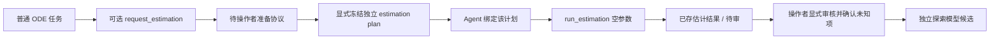

# R02：Agent 估参请求、冻结执行与探索候选

2026-10-27。接续[独立估参任务](parameter-estimation.md)，本轮补编排和审核接口，复用现有 Agent、持久调用、恢复、上下文和进度模块。新增检查使用合成来源和脚本 provider，没有 Goodwin 新效果试验或真实模型成绩。

## 流程与权限



普通 `run_agent(..., estimation_requests=True)` 可使用 `request_estimation`，只接收 `targets:[parameter_id]` 与 `rationale`。工具保存有任务/来源归属的 `parameter_estimation_request` 并暂停。目标是 Agent 提出的待核对名称，不是工具确认的缺失事实；请求不接受数据、参数值、边界、损失或预算，不启动计算。

操作者准备协议时可将原普通运行写入 `parent_run_ref`，沿用独立估参计划的父任务来源/模型检查。请求只是方案，实际参数选择和数据准备由显式冻结的计划决定，不要求将每个提议都采用。

实际估参用一个新 Agent 分支：`run_agent(..., estimation_plan_ref=PLAN_REF)`。来源列表及第一训练实验必须与计划完全一致，创建任务前重检当前源码/依赖环境。该分支使用 reproduction 主入口保存格式，科学任务类型由冻结的 `estimation_plan_ref` 标识；不混入普通草稿、旧研究 study、计划修订、知识搜索、记忆或其他科学设置。

分支只开放 `inspect_progress`、`run_estimation`、`ask_researcher`。`run_estimation` 无参数，不能改计划；执行结束直接停在 `awaiting_input` 待审核，底层失败/超时/不支持则返回 `incomplete`。模型没有审核、采用或将父任务签发完成的动作。`finish`、`submit_draft`、普通 `run` 和读取任意计划对象均不可用于该分支。

## 预算、中断与恢复

`run_estimation` 纳入同一 `InvocationJournal` 的科学执行类别，先保存预留，最多一次，失败也不返还计数。普通请求属于产物写入，消耗所在模型响应调用，不消耗科学执行次数。独立估参核心继续维护自己的计划预留与科学阶段期限。

Agent 返回收据已保存时，恢复会核对任务/计划、结果/执行、模型/训练数据、估计值与实际保存拟合的对应关系，再采用原返回值；不重新调用拟合工具或模型。返回值未确认、工具抛错/中断或科学效果未知时按现有恢复规则阻断，不因为底层目录已有某个结果就静默认领。

`agent-recovery-status` 与 `estimate-status` 分别用于检查 Agent 收据和底层估参记录。恢复仍要求原 provider 身份、当前冻结版本和持久历史一致。只读诊断不证明计算进程仍在活动，也不认证操作者/服务身份。

估参分支不走 `agent-resume` 的文字澄清转来源流程，检查在创建澄清或模型调用之前完成。正常结束和运行前追问都需显式另开合适任务；估计结果不能通过一句“Parameter k = …”被自动写成该分支的新来源。普通任务原有澄清行为保留。

## 审核与模型候选

`estimation_workflow.review` 接收 `approved_for_exploration` 或 `rejected`。允许探索时要求底层计算成功，并逐项确认结果的全部 `unresolved`；局部可辨识性限制、未运行的置信区间、科学支持未知、缺验证数据或单位未知均不能省略。确认未知项不等于消除未知项。

审核为不可变、单一决定；重复或冲突审核不会用于生成候选。`check_result` 重检当前本地对象关系、实际拟合端点、单位/条件/来源类别、诊断与验证记录，拒绝直接改写结果字段后取得审核资格。它是机械一致性检查，不能认证实际计算身份、数据转录的科学正确性或独立领域审核。

`prepare_candidate(REVIEW_REF)` 在批准后生成独立 `estimated_model_candidate` 和派生 SBML 模型，只更新被审核参数的数值。模型引用原模型、实际结果和审核，保存 `fitted_estimate` 元数据，保留原 SBML 单位，不自动推导或换算单位。旧模型、来源和父任务均不改写，也不会自动运行候选。

替换参数的 `symbol/value` 旧证据链接会从派生模型移除；其余未改变目标的链接保留。候选因此不能把新估计值与原文赋值的引用混用，严格来源覆盖检查仍会指出该数值缺少来源。不会生成伪造文献 claim、自动完成严格复现或把 `scientific_status` 升为已验证。相同审核重复准备返回原候选引用。

本轮不提供全局撤销、跨 store 最新审核同步、结果真实性认证、领域签字或将候选自动加入案例库。后续使用候选需按新任务的范围和来源约束明确选择；历史导出闭包不代表完整的最新审核历史。

## 使用接口

```python
# 普通任务仅可提出方案
run_agent(store, provider, sources, experiment, estimation_requests=True)

# 操作者准备的独立计划；参数边界和数据角色由该计划冻结
plan_ref = estimation.prepare_plan(store, config)
run_agent(store, provider, config['source_refs'], first_training_experiment,
          estimation_plan_ref=plan_ref)
```

```bash
# 查看待处理请求，随后按独立估参协议显式准备 PLAN_REF
.venv/bin/python -m biomodel_agent estimate-request REQUEST_REF --store runs/project
.venv/bin/python -m biomodel_agent estimate-prepare --store runs/project --config protocol.json

# Agent 分支；服务参数使用已有配置方式。本轮开发未启动线上服务。
# 该入口可从计划读取来源/第一训练实验；显式传入时必须完全相同。
.venv/bin/python -m biomodel_agent agent --store runs/project --estimation-plan-ref PLAN_REF \
  --base-url PROVIDER_URL --model MODEL_NAME

# 审核命令中，每项未知必须按真实结果逐项填写，示例仅列三个常见项。
.venv/bin/python -m biomodel_agent estimate-review RESULT_REF --store runs/project \
  --decision approved_for_exploration --reviewer OPERATOR --reason 'Explicit exploration decision' \
  --acknowledge global_or_structural_identifiability_unknown \
  --acknowledge confidence_intervals_not_run --acknowledge scientific_support_unknown
.venv/bin/python -m biomodel_agent estimate-candidate REVIEW_REF --store runs/project
```

普通 Agent 的 CLI 通过 `--estimation-requests` 显式开放请求；默认不开启。上述命令是使用说明，不新增材料访问/外发、服务配置或凭证许可。未来产品运行仍遵守现有配置与材料范围。

## 验证与剩余工作

检查覆盖：请求不执行、协议不可改、调用/科学预算、暂停/失败、已返回结果认领、未知结果阻断、错误结果字段、审核未知项、候选隔离、数值旧引用移除、导出和 CLI。都是架构接口或兼容性验证；实际数量、命令与失败记录见[本轮验收](../artifacts/r02-agent-estimation-20261027/acceptance.json)。

已新增[探索候选的显式执行与报告](exploratory-execution.md)，候选读取会只读重建核对审核和模型；沿用原数值工具并保留估计来源。待做：自动整理观测/计算模板的受控流程、更多数据/误差模型与适当的不确定性方法、审核更正/撤回同步、版本迁移及跨任务预算。真实模型是否善于请求、是否改善估计与研究结果，需后续多模型/机制家庭的独立参考和效果评价。R02/T10 继续部分完成。
