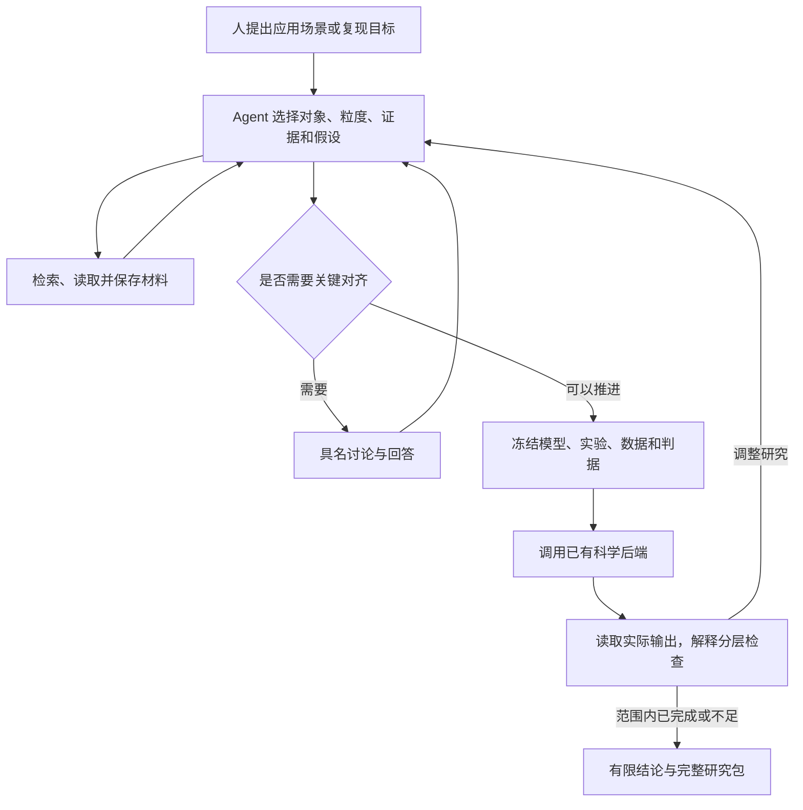

# Agent 研究项目与论文开发流水线

2026-10-30。本轮在原有科学后端外增加研究项目层。用户可以只提出应用场景；Agent 决定研究对象、粒度、证据需求、假设、建模路线和下一轮实验。系统负责保存决定、限定权限和预算、核对工具结果。科学解释的适用性仍需验证。

## 五个流程问题如何落地

| 问题 | 本轮实现 | 验证边界 |
| --- | --- | --- |
| 应用目标如何变成建模任务 | `research_frame` 记录目标、对象、粒度、证据需求、假设、判据；Agent 可修订 | 框架没有替 Agent 证明抽象正确 |
| 如何找材料并判断证据 | 同项目全文片段读取、局部检索、Europe PMC 检索与开放全文导入；精确引文核对 | 检索命中不是证据充分；XML 公式和表格提取仍有未核验警告 |
| 结果如何推动下一步 | 冻结每轮模型、实验和判据；新实验可以链接前一轮，保留旧模型和结果 | 结果产生后的方案改动会被标记；不得倒改旧实验的判据 |
| 该做什么验证 | Agent 提出判据；工具分别给出数值、来源绑定和固定参考比较状态 | 数值成功、来源字面一致、机制适用性是不同判断 |
| 何时讨论、何时结束 | 目标、粒度、数据权限、证据冲突、工具语义不足等问题可触发具名讨论；支持有限完成、证据不足、不支持和停止 | 回答某个问题只满足该问题的对齐；不能代替科学计算或独立审核 |

假设默认允许 Agent 在任务范围内自主采纳，但必须列出声明、理由、依据与未解决问题；也可把项目设为 `assumptions: forbidden`。严格复现不能使用假设草稿。原文匹配只核对引用与声明，不证明文献可靠或适用。

## 一个研究循环



完整原生模型默认直接计算，支持 Boolean、SSA、1D 线性 PDE、格点个体和 FBA；明确的 ODE decision plan 也直接调用原有执行器。它们不需要额外的内层 LLM 发出“运行、结束”。需要旧原生 Agent 流程时可显式 `native_agent: true`；仅从材料继续构建 ODE 的旧入口保留。项目仍需规划模型服务来作研究决定；直接计算不能消除规划调用。

内层调用按每次创建的实验预留累计额度，修订方案不返还额度；直接数学计算预留内层调用为 0。每轮仍占迭代名额。预算来自不可变对象记录，删除 SQLite 索引不能重置它。额度耗尽是停止条件，不是科研成功。

## 验证数据也可以由 Agent 选择

初始参考资料可以由操作者登记；Agent 也可对已授权的 UTF-8 材料调用 `reference_from_source`，选择精确片段：

- `json_reference`：完整字面 JSON 时间序列，或 FBA 的 `{objective, source}`。
- `csv_series`：表头与 2–501 条观测，时间列必须显式写出单位，例如 `time [second]`；Agent 选择观测量与现有列的映射。

Agent 不能在调用参数里填入一组新“正确答案”。工具重新解析源片段，冻结原始数值、映射、提取位置和版本；读取时再次核对。CSV 序列固定尺度为 1，阈值需在实验前冻结；FBA 使用原有标量参考容差。

这解决的是**可追溯的数据选择与字面提取**。列映射、实验相关性、数据质量和证据充分性仍由研究 Agent 判断并说明，数据不会自动获得独立验证资格。场景文本、研究者回答和未核验的 PDF/XML 提取不能通过此入口变成参考答案。任意论文表格、图像曲线与补充数据自动解析仍未覆盖。

完成评估始终要求实际数值检查通过；严格复现还要求来源绑定通过；实验选了参考就必须比较通过。Agent 不能通过省略某条判据绕开这些条件。独立审核状态不由 Agent 代签。判据的自然语言说明是研究提议，实际检查含义以具体后端的报告和固定配置为准。

## 本地使用

```bash
.venv/bin/python -m biomodel_agent workbench --store runs/research-projects --port 8765
```

打开显示地址的 `/projects`。先提出场景，可选入已导入的材料和模型。研究项目页展示方案、证据与假设、讨论、各版实验和实际检查；具名回答后继续同一项目，最终可冻结并导出 ZIP。原资料导入页仍在 `/`。

模型服务默认关闭。启用服务后，每次推进前展示本项目的资料范围和冻结额度，确认覆盖该次有界研究循环，无需人为批准每项建模细节。发生讨论、范围变化或中断后，再次推进会核对新的实际范围。

CLI 的零外部请求示例：

```bash
.venv/bin/python -m biomodel_agent research-project-create \
  --store runs/research-projects --config examples/research-projects/application.json
.venv/bin/python -m biomodel_agent research-project-show --store runs/research-projects PROJECT_REF
```

示例的规划和文献额度均为 0，适合先核对配置。需要在线研究时，在创建前明确填写 `planner_max_calls`、`max_literature_requests` 和服务配置，再显式运行 `research-project-run`。配置和调用行为见 CLI `--help`；模型密钥沿用 `BIOMODEL_API_KEY` 等现有配置。

可用的操作还包括 `research-project-step`、`research-project-reply`、`research-project-recover` 和 `research-project-snapshot`。`step` 接收 `{action,args}` JSON；具名回答只能走操作者入口。运行后检查实际状态，CLI 命令返回 0 本身不表示科研成功。

## 多论文复现开发队列

`research-batch-create/run/show/lessons` 接受开发材料，支持最多 100 个案例，每个案例是独立研究项目。单批总规划、内层、文献和迭代额度先核对、再创建；案例分配之和不能超过冻结总预算。

案例具有 `id`、`paper_id`、`family`、`material_kind` 与项目配置。同一篇论文的多条件、多模型不能充当多篇独立论文。合成控制明确使用 `synthetic_control` 与 `synthetic:` 标识，论文数为 0。当前论文标识和家族由操作者声明，标识数量不能证明材料归属或成功复现。

```bash
.venv/bin/python -m biomodel_agent research-batch-create \
  --store runs/research-projects --config examples/research-projects/development-batch.json
.venv/bin/python -m biomodel_agent research-batch-show --store runs/research-projects BATCH_REF
```

重复执行 batch 命令不会重发已经尝试的案例。对齐或中断的项目需显式查看、回答或采用已确认返回；流水线继续其他案例，并保留文献、提取、建模、计算、验证、上下文/派发和权限等诊断。资料不足和不支持是有效研究结果，不能记作数值成功。

跨案例分析最多使用预先分配的 1 次模型调用，输出带案例指针、适用条件、反例或缺口、验证计划的**经验候选**。当前分析输入以阶段摘要和工具诊断为主，尚未提供自动逐层检索每个案例因果轨迹的学习器。候选默认不激活，不注入后续科学输入；参数值或参考答案不成为通用知识。验证集、独立评价集和留出集不能进入这条经验生产入口。下一阶段应先在更多开发论文与不同家族上检验候选，再决定如何调用它们。

## 中断、导出与结果口径

模型请求、文献请求和计算之前先保留操作记录；不确定是否发生的外部效果不会自动重试。已保存且绑定明确的模型回答、科学结果可显式采用。没有确认回执的操作仍保留未知；当前不是所有本地写入故障都支持自动恢复。

研究快照冻结当时的状态和检查，并导出已知的执行记录、回执、来源与数据选择。后续研究不能改写此前的快照报告。研究包的默认说明是只读核查；显式创建新实验属于新计算，不是“恢复”。复制存储或研究包不建立重试安全性，也不提供跨副本的全局预算锁。

本轮使用脚本响应验证工具协议、真实科学后端、HTTP 和界面交互；脚本成功不能证明真实 LLM 的研究判断或规划可靠性。公开文献接口连通性也不能算作论文复现。完整接受记录另见[本轮验证](validation/20261030/research-projects.md)。

Europe PMC 接口依据[官方开发文档](https://dev.europepmc.org/RestfulWebService)，保留原始响应、出处和提取警告。文献网络默认关闭；开放全文导入并不保证能从公式、图表自动构造模型。
