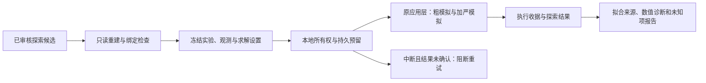

# R02：探索候选的显式执行与报告

2026-10-27。接续[Agent估参流程](agent-estimation.md)，新增 `exploration.py` 与 CLI。执行复用原有应用层、RoadRunner 模拟、加严轨迹和数值裁决；没有新优化器、求解器或自动 Agent 动作。



## 输入与冻结范围

`prepare_plan(store, candidate_ref, config)` 只接受已显式审核的 `estimated_model_candidate`。新只读接口 `estimation_workflow.load_candidate` 重检实际拟合、唯一审核、派生模型数值、元数据和已移除的数值引用；改写模型或恢复旧引用会阻断准备。读取不写对象，准备计划不运行模拟。

配置采用严格 JSON，例如：

```json
{
  "experiment": {"times":[0,0.5,1,2,3],"time_unit":"second"},
  "observations": [{"id":"signal","expression":"x","unit":"dimensionless"}],
  "solver": {"timeout_s":10,"rtol":1e-7,"atol":1e-10,"max_steps":100000},
  "context": {"organism":"synthetic"},
  "rationale": "Explicit exploration under the reviewed context",
  "nonnegative": [],
  "convergence_threshold": 0.001
}
```

实验为 2–500 个时间点，位于 0–10000；观测为 1–8 个显式表达式与单位，ID 不得与模型符号冲突。映射预检复用拟合 profile，只检查输入，不制造数据或调用积分。已知时钟冲突提前阻断，unknown 保留未知。

`context` 必须与原估参声明完全相同，不推断跨物种、条件或单位适用性。显式初值覆盖及其他常量的干预可冻结为探索设置；已估计参数不能被参数覆盖或分段输入改写，即使给的是同一个值也会拒绝。`nonnegative` 仅检查明确列出的状态，不自动宣称生物学守恒。

v1 不接受参考轨迹、评分尺度或重新拟合配置。比较固定为 `not_run`，不会重用训练数据签发文献复现成绩。原模型、来源、父任务和案例目录不被覆盖或自动更新。

## 预算与执行状态

每计划在同一本地 store 中只调用一次应用层，先写预留，并复用本地文件所有权机制防止同计划并发。缓存关闭；最多调用两次模拟器以生成粗轨迹和加严轨迹，粗模拟失败时不启动加严模拟。

`solver.timeout_s` 沿用每次模拟子进程的时限，最多60秒，加严模拟仍使用相同时限。`max_steps` 是原后端积分器设置，最多1,000,000，**不是整个任务的累计步数账本**。数值收敛阈值为明确冻结的正数且不超过1。

父进程预检、报告和存储 I/O 不在 OS 级全任务硬期限内。这里也没有跨 store 全局预算；不能把两次模拟称为整个任务只花一次 `timeout_s`。

| 字段 | 含义 |
|---|---|
| `execution_status` | 原模拟实际状态；没有确认的匹配返回时为 null |
| `numeric_status` | 实际有限性、收敛和明确数值检查结果，不信任另写的成功标签 |
| `status` / `completion_eligible` | 执行成功且必需数值检查通过时才为 succeeded / true；失败、超时和不支持保留 |
| `scientific_status` | 正常探索仍为 not_verified；明确数值失败沿用原裁决，不签发文献验证通过 |
| `scientific_support` / `scope` | 始终 unknown / exploratory_only |

重复请求同一计划返回原结果引用，属于复用，不是独立重跑。预留后中断且未确认返回时阻断自动重试，哪怕底层已有运行文件。`status` 只读显示预留、收据、结果；预留不证明活动进程或完成。

需要新运行时由操作者明确准备新计划；同样设置也产生新计划 ID，实际执行关闭缓存，不重新估参。以探索结果为根导出闭包后可以查看原结果；在兼容环境显式准备新计划可再次运行。导出不保证完整的最新审核/执行历史。

## 报告

通用 `report` 支持 `estimated_exploration_run`，展示探索范围、实际执行/数值状态、拟合参数来源、审核/原模型/估参计划和结果引用、训练资料页/字符位置与 sigma 声明、冻结实验/求解配置、SBML中的实际模型、数值诊断、缺来源目标和轨迹预览。完整轨迹在应用运行对象中，预览最多20行、12列。

参数保持 `fitted_estimate`，不沿用原数值引文。SBML单位保持原声明，不因填了拟合单位就通过维度推导。数据定位不认证转录或统计假设；端点范围不是置信区间。原全局可辨识性、科学支持等未知项及新单位未知一并列出。

报告接口当前会重检同版本冻结环境及候选/审核链。旧源码指纹失效时，需在相应版本运行，或明确重建新的估参/审核/候选与执行计划；当前没有自动迁移或回签机制。历史对象及已有静态报告不覆盖。

```bash
.venv/bin/python -m biomodel_agent estimate-explore-prepare --store runs/project \
  --candidate-ref CANDIDATE_REF --config exploration.json
.venv/bin/python -m biomodel_agent estimate-explore-run PLAN_REF --store runs/project
.venv/bin/python -m biomodel_agent estimate-explore-show RUN_REF --store runs/project
.venv/bin/python -m biomodel_agent estimate-explore-status PLAN_REF --store runs/project
.venv/bin/python -m biomodel_agent report RUN_REF --store runs/project --output report.md
```

Python接口为 `prepare_plan / plan_summary / execute / status / result_summary / load_run`。本入口不调用provider或访问新论文/外部服务。

## 验证与剩余项

合成检查覆盖准备无计算、协议/审核一致性、实际模拟与加严积分、失败/中断、输入错配拒绝、报告、导出与显式新运行。它们是架构/兼容验证，不是模型科研成绩。实际结果见[本轮验收](../artifacts/r02-exploration-execution-20261027/acceptance.json)。

仍待审核更正/撤回及候选/运行失效、跨store最新状态、未知结果显式认领与版本迁移、观测/模板整理及不确定性扩展。真实模型效果和细节优化后续按不同机制家庭评价，不反复堆Goodwin演练或用测试项数概括能力。
