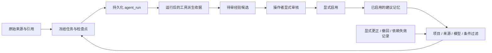

# R06：记忆条件、依赖失效与运行后经验提议

2026-10-26。按本次讨论先搭接口和状态流，后续再做多案例效果评价。Goodwin 保留为已有开发案例；同一模型的变体、运行次数或测试项数不能作为独立科学样本或项目整体能力指标。

## 数据归属与流向

复用已有不可变对象、任务快照、检查点和上下文预算模块，没有另建一套任务状态或记忆数据库。



来源负责参数、初值和方程的证据；任务/计划/检查点负责当前进度、预算和未解决问题；记忆只提供有归属的工作流建议。加载或批准经验不会替代草稿引用检查，也不会签发科学支持。原有 `inspect_progress`、来源按需读取和上下文压缩继续承担长任务状态管理。

## 条件化召回

`memory.remember(..., conditions={...}, depends_on=[...])` 与 `memory.snapshot(..., context={...})` 新增显式条件接口。条件是 1–16 个标签：键为字母起始的有限标识符，值为非空字符串，最长 128 字符。例如：

```json
{"model_type":"ode","task_kind":"reproduction","condition":"A"}
```

只有任务上下文包含记忆声明的所有标签且值完全相同，记忆才可见。缺项或冲突时不召回；不做物种推断、单位换算、模糊匹配或自动认定生物学适用性。项目、已授权来源和模型范围仍同时生效；声明条件不是跨项目、跨来源或跨模型授权。

默认接口保留旧三字段快照和原有行为。显式上下文使用 v2 快照：旧的无条件经验/决定不会自动进入新上下文；无条件偏好仍可用。条件化记忆也不会落入旧无条件任务。v2 召回返回声明条件与依赖，便于检查建议的范围。

Agent 使用 `memory_context={...}` 时冻结上下文，填入工具拥有的 `model_type=ode` 和真实 `task_kind`；调用者不能把 ODE 任务改标成 FBA。该入口需要 `memory_project`，尚未接入 FBA Agent。单独记忆 API 的标签仍是操作者声明。

## 更正与依赖失效

`depends_on` 最多 16 个不同的现存记忆引用，写入时必须在相同项目、来源、模型和声明条件下有效。原记忆更新或撤回后，依赖原版本的建议沿依赖链失效，不自动继承新版本。更窄条件可依赖较宽建议；缺少父建议条件的新记录会被拒绝。

新增 `memory.invalidate_dependency(store, project_id, dependency_ref, author=..., reason=...)`，用于明确记录某个来源、ODE 模型或记忆不能继续作为该项目的经验依赖。记录只追加；当前版本不支持撤销该失效记录。新来源或新模型的出现本身不会被推断成更正，也不会删除原始对象。

新快照排除失效记忆，旧快照在继续推理、写入澄清或恢复前按现有入口重检。只要旧快照中有失效项就停止并要求新任务，避免旧摘要把已撤回内容带回上下文。该机制控制建议记忆，不是科学来源的全局撤销系统，也不改变已完成运行的历史结论。

有效性以当前本地权威 store 中的完整更正历史为准。离线导出是指定根对象的依赖闭包，不自动包含之后或其他分支的撤回记录；不能把旧 bundle 中“未见撤回”解释为全局仍有效。跨 store 同步、全局撤销、并发审核/派生的事务协议和规模性能仍待实现，当前使用串行操作者流程。作者/审核者是声明归属，不是身份认证或独立领域审核。

## 运行后提议、审核与启用

新 ODE reproduction 任务可显式启用 `experience_proposals=True`，需要 `memory_project`。`memory_context` 可额外给出场景标签；未提供时也会冻结真实模型/任务类型。不开放 frozen study 或 FBA Agent。

运行先提交 `agent_run`，随后生成 `experience_derivation`。派生阶段只整理实际任务中保存的失败、未解决问题、阻塞检查与工具建议，不调用额外模型、不生成参数或方程、不消耗原任务调用预算。没有已记录问题时保存 `not_applicable_no_recorded_issue`，不制造经验。

有问题时产生 `memory_candidate`，状态为 pending，保存实际运行、来源、模型、声明条件；实际召回过的记忆会成为候选依赖。之后仍需已有的 `memory-candidate-review` 和 `memory-candidate-activate`。候选、批准但未启用记录都不召回；审核前和启用前均重检依赖，撤回父建议后不能激活其派生经验。更宽条件的推广需要单独有依据的操作者整理，不自动泛化。

收据作为旁支引用运行，不回写原运行，避免循环引用。候选不会进入产生它的运行或已冻结旧快照。按 `run_ref` 可发现收据；串行重复派生返回同一收据。若主运行已提交而派生未写完，可显式补齐；已存在 `derivation_failed` 收据则保留失败，不伪装成功或重新运行模型。I/O 中断可能发生在主运行提交之后，应先查已存运行和收据。

## CLI

以下命令均使用现有本地 store；JSON 参数是文件路径。命令中的引用和内容需替换为实际对象。

```bash
# 记录/查询带条件的建议；--depends-on 可重复
.venv/bin/python -m biomodel_agent memory-add --store runs/project --project p \
  --category experience --author Operator --content-file advice.txt \
  --source-ref SOURCE_REF --conditions context.json
.venv/bin/python -m biomodel_agent memory-search --store runs/project --project p \
  --source-ref SOURCE_REF --query initial --context context.json

# 在原有 agent 命令的科学输入与服务参数之外，显式启用
# --memory-project p --memory-context context.json --experience-proposals

# 查找/补齐运行后的派生收据，不启动推理或科学执行
.venv/bin/python -m biomodel_agent experience-list --store runs/project --run-ref RUN_REF
.venv/bin/python -m biomodel_agent experience-derive --store runs/project --run-ref RUN_REF

# 显式失效；正常更新、撤回仍用 memory-add --supersedes / memory-retract
.venv/bin/python -m biomodel_agent memory-invalidate SOURCE_REF --store runs/project --project p \
  --author Operator --reason 'Corrected source; old advice must be reconsidered.'
```

候选导出以 `experience_derivation` 或候选为根；仅导出原 `agent_run` 不会自动带入后来生成的旁支收据。原运行仍可独立重放。导出不提供完整的最新撤销历史保证。

## 来源适配边界与验证范围

Agent 来源摘要改用 `evidence.source_summary`，不再把所有带 `parser_output_ref` 的来源当成 PDF；JATS 缺少 PDF 页状态时返回 unknown。引用定位显式分派到现有 JATS/PyMuPDF 适配器；未知结构化解析器未注册定位接口时拒绝引用，不借用 PDF 定位。

专项检查用合成来源和脚本 provider 验证条件过滤、传递失效、审核隔离、暂停/恢复、持久响应认领、收据补齐、CLI 与导出。另做直接受影响模块的兼容回归。没有本轮 Goodwin 效果试验、真实 provider 调用或完整测试集重跑；实际数量、命令和日志见 [本轮验收](../artifacts/r06-memory-architecture-20261026/acceptance.json)。

待后续评价：跨机制/模型家庭的多案例任务、记忆有无与上下文策略消融、错误复用/误阻断、证据遗漏、调用与时间成本、规模性能。各案例需独立参考及明确开发/评价归属；同论文变体按家庭归组，不将数值执行成功直接当科学正确。
