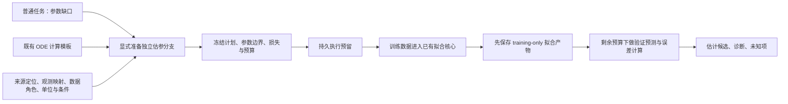

# R02：独立参数估计任务架构

2026-10-27 更新。独立协议与数值核心首轮完成于2026-10-26；现已增加[Agent受控请求、冻结执行、显式审核与探索候选](agent-estimation.md)。继续复用已有 SciPy/DOP853 多起点拟合核心。合成数值控制只验证接口和诊断行为，后续效果评价按不同模型/机制家庭组织。

## 任务边界



`estimation.py` 提供 `prepare_plan / load_plan / plan_summary / execute / status / result_summary`。`fitting.py` 新增只读 `describe_profile / preflight`，对外描述支持范围、检查训练协议和验证实验映射；实际优化、积分、多起点与局部敏感性算法保持原实现。

普通任务可以通过 `parent_run_ref` 关联一个新估参分支：来源必须已经属于父任务；父任务已有模型时必须使用该模型。分支不改父任务状态、科学协议或调用计数。父任务尚无可执行模型时，操作者需显式准备有数值初值和方程的计算模板；拟合参数的模板值只是计算输入，优化初始点由冻结边界/种子生成，不是补造文献事实。

当前可通过 Python/CLI 显式准备计划，或由 Agent 在开放请求后提出待处理方案；实际执行仍需操作者绑定冻结计划。结果显式审核后可生成独立探索模型候选，不改变原普通任务。自动整理数据/计算模板、自动推进父任务和更多科研 Skill 尚未接入，R02/T10 整体仍未结项。编排与审核接口见[Agent估参流程](agent-estimation.md)。

## 输入协议

计划冻结以下字段，并保存当前源码/依赖环境指纹。环境改变后拒绝执行旧计划，需显式新建，不回写历史。

| 字段 | 约束与意义 |
|---|---|
| `model_ref` | 已有 ODE `model`；仅支持既有 `rate_rule_fitting_v1` 子集，不扩展到反应网络、FBA、未知初值或未知方程 |
| `source_refs` | 1–32 个明确授权来源；每条数据记录须有其中一个来源的页/字符位置 |
| `observations` | 1–4 个显式 ID、表达式与单位；表达式在实际模型符号上预检 |
| `parameters` | 1–8 个已有常量参数；每项有有限上下界、声明单位和边界理由；不允许用实验覆盖值同时覆盖拟合参数 |
| `training` / `validation` | 角色显式，ID 不重叠；各最多 8 个条件，每条件 2–500 个时间点，0–10000，总计不超过 8000 个标量样本 |
| 数据列 | 必须恰好匹配观测 ID 和时间网格；有限数值；不接受缺值、自动补值或数字字符串/布尔数值 |
| `sigma` | 每条件、每观测一个正有限标量；独立高斯且已知 sigma 是操作者的冻结假设，需写 `sigma_origin`，不是系统从数据估出的事实 |
| `units` / `context` | 数据单位与观测单位精确匹配；数据条件与计划条件精确匹配，沿用参数适用性模块的有限条件词汇；不推断同义、物种关系或换算 |
| `provenance` | 来源、页、起止偏移、数据类别及 sigma 来源；工具重读原文保存 quote。类别为 `operator_supplied`、`literature_transcription` 或 `synthetic_control` |
| `rationale` | 为什么另开估参任务；不是科学审核决定 |
| 可选预算 | `starts` 1–8，`max_nfev` 1–1000，非负 32 位 `seed`；拟合最多 90 秒，总科学阶段最多 300 秒，默认分别 60/120 秒 |

时间单位沿用现有契约：已知且冲突的模型/实验时钟在执行前阻断，明确 unknown 保留未知。参数单位使用现有有限声明集合或 `unknown`；观测单位须与数据声明相同。声明匹配不表示已经完成 SBML 全维度推导或科学适用性审核。

来源定位只证明本次输入引用了哪段材料，不证明转录数值、误差模型或数据角色在科学上正确。训练/验证角色隔离保证验证数组不进入优化器；来源文本本身、同源数据或操作者之前已见数据不因此成为独立盲测。

没有训练数据、缺关键初值、缺方程或不支持的数据格式时，准备失败，不启动拟合、不写入有效计划。不得为让拟合执行而自动猜数或放宽严格复现入口。

## 状态与结果

执行前先写 `parameter_estimation_execution` 预留。相同本地 store 中，同一计划受文件所有权锁保护。已保存结果时重复执行返回原结果引用，不重新拟合；预留后中断且无确认结果时，状态为 `reserved_result_unknown_do_not_retry`，阻止自动重试。只读 `status` 不把预留记录解释为仍有活动进程。暂不提供未知结果认领/自动恢复。

拟合仅接收训练数组与冻结参数边界。完整拟合结果先保存到 `fitting`，其直接依赖为模型与训练数据产物；然后才计算验证预测和加权 RMSE。验证误差不反过来改变边界、起点、参数、模型或再次拟合。验证没有设置“科学通过”阈值；它只返回实际数值误差。

拟合与后续验证共享剩余科学阶段预算，子进程调用包含启动/等待并在结束时清理。预检、文件锁和对象 I/O 不宣称受整个操作系统级总时限保护；该接口也不是沙箱或跨 store 的全局预算协议。显式准备新计划是新的操作者任务，不是旧计划自动续费。

返回的 `execution_status` 为 `succeeded / failed / timed_out / unsupported`。技术执行成功时仍保留 `scientific_status=not_verified`、`global_identifiability=unknown`、`confidence_intervals=not_run`。没有验证数据时 `validation_status=not_run`，不会伪装验证通过；验证失败/超时则整个执行不标成功，可保留此前已提交的训练拟合候选。

每个参数输出带 `origin=fitted_estimate`、`adoption_status=candidate_only`、单位/条件、训练边界和多起点端点范围。原始来源、模板、草稿、父任务均不改写，不自动生成参数来源或 claim，不将估计值升级为文献报告值。

诊断保留实际局部秩、条件数和完整起点记录；出现局部秩亏、条件数高或近似同代价的不同端点时记录警示。v1 的条件数阈值 `1e8`、代价容差 `1e-6 * max(1, best_cost)` 和边界跨度比例 `.001` 是显式工程启发式，随结果保存，不是统计显著性或可辨识性证明。边界、多起点端点范围不是置信区间；多个近似等价值继续保留。

结果导出以 `parameter_estimation_result` 为根，包含计划、预留、来源、模型和已保存拟合依赖；只导出旧计划不会自动包含之后产生的旁支运行。跨 store 复制不保证完整的最新执行历史或全局预算。不同版本环境不可静默续跑旧计划。

## 使用

```bash
.venv/bin/python -m biomodel_agent estimate-prepare --store runs/estimate --config protocol.json
.venv/bin/python -m biomodel_agent estimate-plan PLAN_REF --store runs/estimate
.venv/bin/python -m biomodel_agent estimate-run PLAN_REF --store runs/estimate
.venv/bin/python -m biomodel_agent estimate-status PLAN_REF --store runs/estimate
.venv/bin/python -m biomodel_agent estimate-show RESULT_REF --store runs/estimate
```

`protocol.json` 中 `training` 与 `validation` 的每条记录结构相同，角色分别写 `training` 与 `validation`。完整可执行输入组装方式见 [合成接口检查](../tests/test_estimation_architecture.py) 的 `setup`；其中数据是解析构造的开发控制，不是待评价论文。

```json
{
  "model_ref": "EXISTING_ODE_MODEL_REF",
  "source_refs": ["AUTHORIZED_SOURCE_REF"],
  "observations": [{"id":"signal","expression":"x","unit":"dimensionless"}],
  "parameters": {"k":{"bounds":[0.05,1.5],"unit":"second^-1","rationale":"Explicit design bounds"}},
  "context": {"organism":"synthetic"},
  "rationale": "Separate explicitly authorized estimation branch",
  "training": [{
    "id":"train", "role":"training", "experiment":{"times":[0,1],"time_unit":"second"},
    "values":{"signal":[1,0.5]}, "sigma":{"signal":0.02},
    "units":{"signal":"dimensionless"}, "context":{"organism":"synthetic"},
    "provenance":{"source_ref":"AUTHORIZED_SOURCE_REF","page":1,"start":0,"end":10,
      "origin":"synthetic_control","sigma_origin":"Analyst control assumption"}
  }],
  "validation": [], "starts":3, "seed":17, "max_nfev":100,
  "fit_timeout_s":60, "total_timeout_s":120
}
```

引用需替换为实际 store 对象，偏移需对应真实材料。`parent_run_ref` 可选，若提供则按父任务来源/模型重检。没有 CLI 参数可以把估计结果直接发布为来源或完成父任务。

## 本轮检查与后续

本轮只做协议/状态/兼容验证：冻结、数据范围、数值类型、单位/条件、预算、单次执行、失败/中断、导出和父任务隔离。两个简单合成控制分别检查单参数数值恢复及只能识别参数和时保留不同端点。没有 Goodwin 新试验、线上 provider 调用、独立领域审核或项目科研效果成绩。实际结果见 [验收记录](../artifacts/r02-estimation-architecture-20261026/acceptance.json)。

探索候选已接通[显式执行与报告](exploratory-execution.md)。后续架构接口为观测/模板整理、审核更正/撤回、更多观测/误差模型、初值估计和合适的局部/预测不确定性方法；需分别明确前提，不能将当前端点范围当置信区间。实际效果、多家庭案例、长期任务成本和误采用率另行评价。
