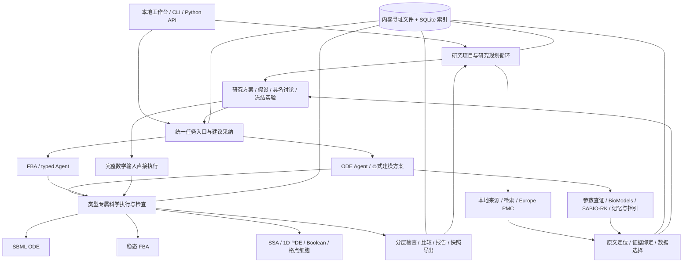

# 项目架构检查与后续优化规划

检查日期：2026-11-01。源码基线：`593affca82ee2b16afd798752d0623536fd4434c`。本报告基于当前源码、依赖、测试、CI 和已有验收记录；初始 Git 工作区无未提交修改。本次产物为盘点和规划，未修改产品实现。

同日补充核查：已离线复现三个产品问题，分别涉及正式模型适配器与研究循环的响应契约、批次经验提取协议、已保存回答的前端续接。详见[具体任务与已确认问题](execution-plan-20261101.md)。三个问题随后已修复，并完成正式适配器集成、能力目录和小批真实服务试用，见[改进交付](validation/20261101/improvements.md)。此前回归通过不表示这些新增检查路径也通过。

## 1. 总体判断

项目已经具备可审计建模系统的主要工程骨架：本地工作台、研究项目循环、六类任务路由、来源与证据管理、有界科学计算、暂停恢复、版本化结果和导出。当前最成熟的建模主线仍是小规模 ODE；其余五类拥有各自受限的执行语义。

下一阶段的主投入建议放在 **真实材料 → 可信数学模型 → 可解释验证** 这条路径上。优先用小批真实开发任务找出瓶颈，再补资料提取、建模接口和验证能力。基础设施已有较多建设，继续增加后端类型、流程名称或测试数量，不能直接回答真实用户能完成哪些科研任务。

必须区分三种能力：

1. **已有数学输入的计算能力**：六类后端均有实现。
2. **Agent 提出假设模型的能力**：研究项目层已提供工程入口，可在显式假设下提交原生模型或 ODE decision plan；真实判断质量尚待评测。
3. **从论文忠实重建并验证模型的能力**：ODE、有限完整文本 Boolean/SSA 声明有来源绑定路径；尚不能泛化为六类任意论文自动复现。

特别注意：旧任务页中“FBA/PDE/个体需要准备原生输入”，与新研究项目层“Agent 可提出显式假设模型”并不矛盾。入口、研究模式和证据要求不同。源码依据为 [`research_projects._open_iteration`](../src/biomodel_agent/research_projects.py)、[`_source_check`](../src/biomodel_agent/research_projects.py) 和 [`research_tasks.preflight`](../src/biomodel_agent/research_tasks.py)。

## 2. 当前实际架构

这是一个 Python 模块化单体，使用自建的有界 Agent 动作循环。外层研究规划器与按类型执行流程分层；部分旧流程仍可调用内层模型。完整数学输入可直接执行，因此不是每次科学计算都要再经过一次 LLM。

图中表示主要职责与调用关系，不表示所有类型已共享同一套能力。执行账本、冻结预算、所有权和源码指纹贯穿这些模块。

| 层次 | 主要文件（均位于 `src/biomodel_agent/`） | 已实现职责 |
|---|---|---|
| 用户入口 | `cli.py`、各专题 `*_cli.py`、`workbench_server.py`、`workbench_assets/` | CLI、原生 HTML/CSS/JS 页面、回环 HTTP 接口 |
| 工作台作业 | `workbench.py` | 后台串行作业、提交认领、状态查询、资料范围确认、结果下载 |
| 研究项目 | `research_projects.py`、`research_supervisor.py`、`research_pipeline.py` | 场景到研究方案、假设、讨论、多轮实验、开发批次和经验候选 |
| 任务与建议 | `research_tasks.py`、`task_proposals.py`、`boolean_proposals.py`、`stochastic_proposals.py` | 六类选型、输入预检、来源草稿、显式采纳、类型分派 |
| 建模与 Agent | `agent.py`、`agent_tools.py`、`modeling_plan.py`、`modeling_workflow.py`、`native_modeling.py`、FBA/typed runtime | 有界动作循环、建模方案、编译、执行和受控续接 |
| 来源与知识 | `evidence.py`、`bindings.py`、`source_review.py`、`retrieval.py`、`pdf_adapter.py`、`jats_sources.py`、`knowledge.py`、`research_literature.py` | 材料导入、原文定位、字面与目标绑定、检索和外部数据库适配 |
| 科学计算 | `modeling.py`、`simulation.py`、`fitting.py`、`estimation.py`、`studies.py`、`fba.py`、`typed_models.py` 及四类后端 | 数学输入验证、受限子进程计算、估参、候选比较、数值检查 |
| 持久化与恢复 | `storage.py`、`invocations.py`、`recovery.py`、`local_ownership.py`、`read_views.py` | SHA-256 对象/blob、SQLite 索引、预留与返回账本、结果认领、查询级校验缓存 |
| 解释与交付 | `reporting.py`、`bundles.py`、`timeline.py`、`research_references.py` | 工具事实驱动的报告、原始证据闭包、参考数据来源、离线核查与显式重跑 |

实际代码仍以平铺模块和函数直接调用为主。`domain/contracts.py` 提供不可变契约，但并非所有模型类型都已通过统一的后端接口；ODE、FBA、typed 的历史协议分别保留。

## 3. 已实现功能与边界

### 3.1 六类模型

| 类型 | 当前计算实现 | 输入构建与研究能力 | 主要边界 |
|---|---|---|---|
| ODE | libSBML 构建/检查；RoadRunner 模拟；数值稳定性与固定参考比较 | 来源草稿、显式 decision plan、引用修复、缺口澄清；受限估参与候选比较 | 小规模受限 SBML；显式方案主要为 rate-rule 路线；通用事件、延迟、任意论文语义未覆盖 |
| FBA | 原生 JSON / strict FBC v2；SciPy HiGHS 稳态 LP；原对偶与参考检查 | 导入模型、原生 Agent、恢复；研究项目可提出显式假设网络 | 非动态 FBA；没有 FVA/MILP/通用基因干预；严格来源草稿路线未打通 |
| 随机反应 | 自实现 Gillespie direct SSA，固定种子，多轨迹 | 原生 JSON；完整文本声明到来源绑定模型；项目假设草稿 | 充分混合、整数分子数、0/1/2 阶质量作用；不自动做浓度常数转换 |
| PDE | SciPy 稀疏矩阵指数推进空间离散系统 | 原生 JSON；项目显式假设模型 | 仅 1D 单场线性扩散与衰减、均匀网格和三类受限边界；不是通用 PDE 求解器 |
| Boolean | 自实现同步 / 随机顺序更新，静态钳制，逐步规则检查 | 原生 JSON；有限完整文本规则的来源绑定；项目假设草稿 | 不自动推断生物调控规则；异步重复状态不被当作吸引子证明 |
| 个体模型 | 自实现二维格点细胞死亡、迁移、分裂、占位和亲子记录 | 原生 JSON；项目显式假设模型 | 非连续空间、无细胞力学、无化学场耦合；每轮概率不能直接当连续速率 |

SSA/PDE/Boolean/个体通过 [`typed_models.py`](../src/biomodel_agent/typed_models.py) 共享导入、冻结、子进程执行、检查、导出与重跑。类型专属输入和验证仍分别保留。

### 3.2 横向能力

| 能力 | 当前状态 | 尚未完成 |
|---|---|---|
| 研究项目循环 | 已实现方案修订、具名讨论、冻结实验、关联迭代、实际输出检查和有限结论 | 新外层研究循环的系统性真实 LLM / 真实论文效果评价 |
| 材料解析 | UTF-8、pypdf、可选 PyMuPDF；JATS 图片公式缺口与候选来源链 | 通用 OCR、数学公式识别、跨页表格和复杂补充数据自动整理 |
| 引文与参数 | 精确原文位置、目标数值/表达式绑定、冲突阻断、单位/条件核对 | 生物学适用性自动认证；复杂语义等价与一般单位推导 |
| 检索 | 授权材料内的 `lexical_v1` / `passage_v2`；外部公开库受控请求 | 全文语义检索和稳定的真实任务召回质量证据 |
| 参考与验证 | 冻结参考；研究层可从 UTF-8 JSON/CSV 字面选取数据 | 项目级序列参考目前面向 ODE，FBA 使用目标值；其余类型缺少同等的数据比较协议 |
| 参数估计 | 有界参数、多起点 SciPy 最小二乘、冻结数据角色和独立分支 | 通用不确定性、复杂观测模型、跨后端估参；历史 R02 后续扩展仍暂缓 |
| 假设比较 | 预定义候选、训练/留出区分、可报告不可区分或无合格候选 | 开放式机制发现的实际能力证据 |
| 记忆与案例 | 条件化记忆、依赖失效、候选审核/激活、固定案例装载与重跑 | 多类型统一接入、家族外收益验证；研究批次经验候选默认不自动激活 |
| 科研指引 | 三项可加载、检查实际产物的 ODE reproduction 流程契约 | FBA/typed 的等价流程与真实消融收益 |
| 暂停和恢复 | ODE、FBA v2、typed v2；已有返回受控认领；未知效果阻断重试 | 任意中断自动恢复、跨 store 全局幂等、完整研究总期限和取消协议 |
| 本地工作台 | 导入、建议、原文核对、采纳、追问、作业、报告、ZIP、研究项目页 | PDF/FBC XML 直接上传、科学图形交互、模型版本差异视图、取消运行 |
| 分发与测试 | Python 3.12 锁定环境；Linux/Windows 启动包；离线 CI | CI 当前仅 Ubuntu；Windows 主要依赖专项验收，未进入常规矩阵 |

### 3.3 工具接入清单

以下是**项目自身**的工具集成，不能与当前 Codex 会话可用的插件混为一谈。

| 工具/库 | 接入位置 | 用途和状态 |
|---|---|---|
| OpenAI-compatible Chat Completions | [`llm.py`](../src/biomodel_agent/llm.py) | 自建 `ChatProvider`，使用 `httpx` 发送 `/chat/completions`；接收单一 JSON 动作；地址、模型、密钥环境变量由运行者配置 |
| libSBML | `modeling.py`、`fba_sbml.py`、`fitting.py` | SBML 解析、构建、能力检查；底层标准支持不等于产品完整支持 |
| libRoadRunner | `simulation.py` | ODE 计算后端 |
| NumPy / SciPy | 各计算模块 | 数值数组、独立 ODE / 估参、HiGHS LP、稀疏矩阵指数、峰值分析 |
| pypdf / PyMuPDF | `evidence.py`、`pdf_adapter.py` | 默认 PDF 文本提取 / 可选带位置结构提取；未核验表格不直接变成证据 |
| BioModels | [`knowledge.py`](../src/biomodel_agent/knowledge.py) | 模型搜索、文件清单、SBML 下载；ODE Agent 可按配置搜索，导入另走显式入口 |
| SABIO-RK | `knowledge.py` | 动力学记录搜索/导入，保留单位与条件；不自动采用参数 |
| Europe PMC | [`research_literature.py`](../src/biomodel_agent/research_literature.py) | 研究项目层文献搜索和开放全文获取，单独预算，保留原始响应与解析警告 |
| SQLite + 本地文件 | `storage.py` | 轻量索引与内容寻址权威文件；非向量数据库 |
| Pillow / matplotlib | `paper_reference.py`、开发图形流程；可选 figures 依赖组 | 有限论文图像参考诊断与绘图；不是工作台通用图表组件 |
| 外部 Agent 工作区 | `workspace_tools.py`、`workspace_assets/` | CLI/Python 命令、模板、操作指引和环境检查；没有据此形成标准 MCP 服务端 |
| Node / DSH 开发脚本 | `scripts/dsh-workflow.mjs`、`scripts/lib/` | 开发、进程监督和诊断工具；不属于产品运行时多 Agent 架构 |
| Talk2Biomodels / KinModGPT | `benchmarks/development/` 中对照 runner | 历史对照实验适配，依赖单独源码快照/环境；不属于主产品依赖或统一工具目录 |

外部数据库与模型服务本次仅检查接入代码和离线测试，**未验证 2026-11-01 的在线连通性或真实服务效果**。已配置某个兼容接口不等于接入了当前 Codex 会话的模型或权限。

ODE 的动作包括来源读取/检索、知识搜索、参数查证/评估、记忆召回、指引加载、提交草稿、估参/研究执行、计算、进度、追问和结束；显式启用时还可提交建模方案。研究项目层另有方案修订、文献获取、参考提取、实验创建/执行/检查/评估、讨论与结论动作。两层动作集合并不相同，扩展工具时应先明确放在哪一层。

## 4. 检查发现与优化判断

以下为已核对的架构缺口或风险，不将未复现的风险写成已发生故障。

| 优先级 | 发现与证据 | 影响 | 建议 |
|---|---|---|---|
| P0 | 最新研究循环验收使用脚本响应；2026-10-31 摘要明确 `live_model_requests=0`、`real_papers_reproduced=0` | 无法由工程验收推断真实规划、选型和证据判断质量 | 先开展冻结协议的小批真实开发任务评测，保留失败、澄清与拒绝的分母 |
| P0 | PDF/XML 提取保留未核验警告；严格绑定依赖有限声明语法；`research_references` 仅接收指定 UTF-8 数据 | 真实论文可能在进入求解器前就因公式、表格、单位或映射阻塞 | 优先补可核查的材料与数据适配链，并提供人工修订入口 |
| P1 | `research_projects._open_iteration` 的序列参考限制为 ODE，FBA 为目标值；其余类型主要依赖内部检查 | “后端支持六类”与“六类科学验证完备”之间存在缺口 | 按真实任务需求增加类型专属比较契约，尤其随机分布/离散状态/空间误差 |
| P1 | `agent._execute_agent` 为 779 行；`agent.py` 1283 行，`cli.py` 1012 行，`research_projects.py` 887 行；跨模块调用部分下划线函数 | 动作、状态、预算和恢复改动容易互相牵连 | 分步提取动作处理器、公开应用接口和后端能力目录，保留现有契约测试 |
| P1 | 规划器提示、任务建议、能力输出、CLI、前端分别描述能力；旧专题正文与最新增量并存 | 用户和开发者容易误判入口支持范围，新增类型需要多处同步 | 建立包含“模式/入口/来源构建/验证/恢复”的能力注册表，供 UI 和提示读取 |
| P1 | `research_supervisor.usage` 在存在内层调用时保留总 token 未知；默认策略无项目总墙钟期限；工作台没有取消动作 | 长任务成本与等待时间难以预期 | 统一用量汇总、阶段耗时和研究总期限；先支持安全边界停止，再设计中断认领 |
| P1 | 项目页面主要展示文本/结构化详情，输入仍较依赖 JSON；资料导入从原生任务页进入 | 用户不容易直观看见假设、模型和结果的变化 | 增加来源定位、输入表单、版本差异和类型适配结果图；保持图由冻结结果生成 |
| P2 | Python 产品源码 83 文件、21833 行；94 个测试文件；CI 仅 Ubuntu；旧 backlog 顶部仍含已完成项的“下一项” | 维护与发布成本增加，状态分散 | 把当前路线图集中到一个入口，保留历史记录；补 Windows 最小烟雾检查和分层测试 |

代码规模只用于定位维护热点，不等于缺陷数量。现有查询缓存已经做过优化，不应再次笼统提出“加缓存”；后续以真实数据量下的读取次数、p95 延迟和内存为依据。独立评价集未在本次检查中打开。

## 5. 后续优化具体放在哪些模块

建议沿用现有单体结构，先提取明确接口，再考虑目录迁移。下面的新文件名是建议落点，并非已存在实现。

| 工作包 | 主要落点 | 交付物 | 验收标准 | 依赖/优先级 |
|---|---|---|---|---|
| A：真实任务基线 | `benchmarks/development/`、`research_pipeline.py`、`docs/validation/` | 小批真实开发材料、冻结输入/参考/服务/预算、失败分类报告 | 分开报告提取、建模、执行、数值、来源、人工介入、时间和 token；失败不移出分母；领域审核单列 | 首先，P0 |
| B：能力契约 | 建议新增 `capabilities.py`，接 `typed_models.py`、`research_tasks.py`、`task_proposals.py`、`research_supervisor.py` | 六类型 × 研究模式 × 入口的能力目录；一致的 unsupported 原因 | CLI、提示、工作台与实际调度一致；保留 ODE/FBA/typed 专属契约；旧入口兼容 | 可与 A 并行推进，P1 |
| C：材料与观测数据 | `pdf_adapter.py`、`jats_sources.py`、`evidence.py`、`bindings.py`、`research_references.py` | 公式/表格候选、原文区域定位、人工修订记录、观测列/单位/条件映射 | 每个被采用字段可追到原材料和转换记录；错误单位、错列、缺公式、冲突不会静默通过 | A 的失败证据决定首批范围，P0 |
| D：工作台闭环 | `workbench.py`、`workbench_server.py`、`workbench_assets/` | PDF 接入现有解析器、缺口引导、版本差异、结果图和导出入口 | 真实用户完成一次“导入—修订—计算—核查—导出”；刷新不重复执行；图表单位/种子/参考可核对 | 依赖 B/C 的稳定接口，P1 |
| E：编排与用量 | `agent.py`、`research_supervisor.py`、`invocations.py`、`recovery.py`、`deadlines.py` | 独立动作处理器、公共执行接口、统一用量/耗时、项目期限和安全停止 | 已确认返回不重算；未知效果不重试；预算不因恢复重置；缺失 usage 仍标未知 | 分步实施，P1 |
| F：科学验证补齐 | `validation.py`、`typed_models.py`、各类型 `checks`、`research_references.py` | 按需求增加随机统计比较、PDE 网格收敛、Boolean 状态序列/干预比较、个体模型汇总指标 | 比较协议先冻结，有适用的参考或解析控制；数值成功与科学支持分开呈现 | A 发现实际需求后，P1/P2 |
| G：经验复用验证 | `memory.py`、`memory_candidates.py`、`case_library.py`、`scientific_skills.py`、`research_pipeline.py` | 基于开发案例生成、审核、适用条件过滤的经验；有/无经验对照 | 来源变更和反例使经验失效；家族外验证；不把参数或参考答案升级为通用知识 | A/C 稳定后，P2 |
| H：发布与文档 | `.github/workflows/tests.yml`、`scripts/runtime/`、`docs/README.md` | Linux/Windows 核心烟雾检查、测试分层、当前状态索引 | 干净安装、中文路径/换行、最小六类执行与导出可用；不依赖本地历史归档 | 配合每阶段发布，P1/P2 |

### 推荐实施顺序

**阶段一：先获得真实失败分布。** 建议先选 6–10 个开发案例，覆盖多个机制家庭，以当前较完整的 ODE 为主，辅以显式 Boolean/SSA 和一个已准备 FBA 输入。案例数是启动规模建议，不是统计充分性的保证。完整声明、论文原文、缺失/冲突控制分别统计；同一论文的变体不能充当独立论文。初次尝试和修复后的重跑分开保留。

此阶段产出 A，同时做 B 的最小版本；不必先重构整个项目。固定模型服务与额度，记录材料和源码哈希。线上执行需按已有服务配置与发送范围确认机制启动，本次盘点不启动付费调用。

**阶段二：修复最常见且影响最大的阻塞。** 从 C 中选出前两类失败，连同 D 的审阅/修订/结果展示一起打通。若失败集中在提示/动作协议，则先修 B/E；若集中在原文公式与数据，则先修 C。每项修复在原失败案例及未参与修改的同类开发控制上核验。

**阶段三：增加结果可信度与稳定性。** 按真实需求推进 F；结合 E 完成必要的动作拆分、成本汇总和期限控制，再开展有/无检索、记忆或科研指引的对照。R02 估参扩展保留历史暂缓状态，只有真实任务证明它是主瓶颈后再重新排序。

**阶段四：扩大范围。** 在开发协议稳定后，再做家族外评价和独立审核。是否扩展非线性 PDE、动态 FBA、混合模型或多 Agent，应由需求和对照收益决定。当前没有必要先引入微服务、向量数据库或新的自主角色体系。

## 6. 本次验证与证据口径

### 本次检查

- 静态检查覆盖源码入口、研究循环、类型分派、来源/参考限制、求解器依赖、工作台、存储与恢复设计、CI、当前和历史文档。
- CLI `--help` 与 `model-types` 均成功运行。
- 本次定向回归共 **323 个不同测试最终通过**：首批 319 项中 313 通过，6 项 HTTP fixture 因受限沙箱禁止创建 socket 而报错；获准使用本机回环端口后，同一组 6 项全部通过。另外补充的 4 项 ODE 模拟/方案/错误绑定检查通过。没有修改测试或产品代码来获得通过。
- 首批耗时 172.10 秒，HTTP 重跑 2.61 秒，ODE 补充 8.06 秒。覆盖研究项目与执行、工作台 HTTP、统一任务、四类 typed 后端、FBA、公开知识/文献离线适配、只读视图、连接生命周期和部分 ODE 核心路径；不是完整测试集重跑。
- [可共享检查摘要](validation/20261101/project-audit-summary.json)保留测试数量、错误归因和日志哈希；原始日志位于 `runs/project-audit-20261101/`，该目录按仓库约定不跟踪。首次受限日志未覆盖。
- 本次没有进行线上模型/数据库调用、真实浏览器验收、原生 Windows 重测或完整科研能力评价。

### 历史证据

[`2026-10-31 验收摘要`](validation/20261031/query-read-performance-summary.json)记录 Linux 全量 **2694 passed、1 skipped**，Windows 专项 **82 passed**，前端 HTTP 回归 **72 passed**。这些数字对应历史记录中的实现和环境，不是本次全量重跑结果。

该摘要同时明确真实模型请求为 0、真实论文复现为 0、科学支持 unknown。此前 [`native-plan-pilot.md`](native-plan-pilot.md) 有已见合成案例的真实模型先导；因此应表述为“最新研究项目增量尚无真实论文效果证据”，不能扩大为“整个项目从未调用过真实模型”。

旧 [`architecture.md`](architecture.md) 是设计提案；[`optimization-backlog.md`](optimization-backlog.md) 保留历史 T/R 编号、当时优先级和验收。本报告作为当前盘点与建议入口，历史证据不覆盖、不重新认证。
