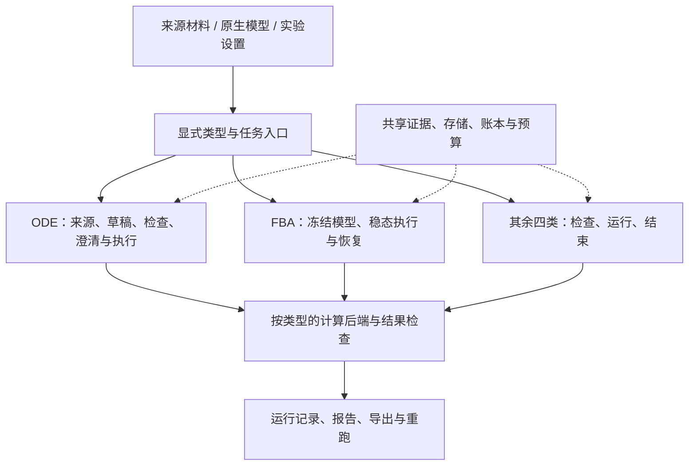

# 项目进展与下一阶段建议

后续增量：[统一任务入口与六类续接](research-tasks.md)已接入显式选型、输入缺口、状态和原生类型 v2 恢复；尚无自主选型或通用论文建模。

后续增量：2026-10-29 已接入[显式建模方案 IR、执行收据与外部工作区](modeling-decisions.md)。本文保留 2026-10-28 的盘点与当时建议，最新功能边界见[支持矩阵](current-support.md)。

核对日期：2026-10-28。依据为当前工作区源码、CLI、功能文档及已有验收记录；这是项目盘点，不是新增科学效果评价。工作区有大量未提交增量，不能用当前 Git HEAD 代表以下全部功能。

## 当前阶段

项目已经形成一个有证据记录、计算检查、预算与部分恢复能力的生物建模 Agent 原型。ODE 主流程最完整，FBA 已有独立稳态工作流，另外四类具有有限范围的原生执行路径。下一阶段的重点是把这些能力连接成研究者能够实际完成任务的流程，并测量真实效果。

目前适合的描述是：**多类型科学计算底座已建立，Agent 的跨类型任务能力仍在完善，科研有效性尚待系统验证。** 不宜给出一个总完成百分比，因为计算执行、自动建模、工程可靠性和科学评价的成熟度不同。

## 已完成到什么程度

| 部分 | 当前能力 | 尚需补齐 |
|---|---|---|
| ODE 主线 | 指定来源读取/检索、方程与参数草稿、证据绑定、SBML 构建、模拟、数值和参考检查、报告/导出 | 任意论文解析、一般语义支持与科学适用性；真实任务上的完成质量 |
| 稳态 FBA | 原生 JSON / 有限 FBC v2 导入、LP 求解、残差/边界/目标检查、Agent 路由、显式 v2 暂停与恢复 | 从研究问题整理模型、动态 FBA/FVA/MILP、更广生物学验证 |
| 随机反应 | 质量作用 SSA、有限轨迹集合、种子与事件预算、统计量和守恒检查 | 任意倾向函数、浓度参数转换、论文到模型与 Agent 恢复 |
| PDE | 1D 线性扩散–衰减、三种边界、离散计算与质量检查 | 非线性/多场/多维、自动模型构建与 Agent 恢复 |
| 布尔网络 | 明确规则、同步/随机顺序更新、钳制、轨迹重检 | 规则推断、一般吸引子分析、Agent 恢复 |
| 个体模型 | 二维格点细胞的死亡/迁移/分裂、占位与亲子事件检查 | 连续力学、场耦合、领域特定规则、Agent 恢复 |
| 执行可靠性 | 调用账本、一次执行约束、部分路径的结果认领、来源/数值错误反馈 | 跨类型一致的生命周期、全任务期限与跨分支预算 |
| 计划/记忆/科研指引 | ODE 有限计划修订、失败路由、条件化记忆与失效、待审经验、工具依赖与产物检查 | 跨类型接入、跨 store 撤销、长任务与消融效果 |
| 参数估计 | 冻结数据角色/观测/边界/预算、拟合与验证、Agent 请求/执行、审核后探索候选及运行报告 | 自动数据/模板整理、不确定性与可辨识性扩展、审核撤回传播；既有安排为后续暂缓 |
| 来源与复用 | PDF 薄适配、JATS 图像缺口定位、BioModels/SABIO-RK 基础接入、本地固定案例目录 | OCR/公式识别、复杂表格、条件判断、自主选择与采用 |
| 评价 | 材料卡、审核准备、分层报告、离线对照接口、进程采集和轨迹核验 | 当前版本真实系统先导、独立领域审核、同模型归因及正式未见评价 |

详细边界见[支持矩阵](current-support.md)和[六类模型接口](model-types.md)。

## 实际架构

当前是单个逻辑 Agent、模块化单体，各类型保存原生模型载荷。公共层负责证据、存储、调用账本、预算与报告；各后端负责其科学语义和检查。没有必要仅为扩展类型而改成多 Agent 或微服务。

源码入口：[`agent.py`](../src/biomodel_agent/agent.py) 的 `run_model_agent` 显式分派模型类型；[`typed_agent.py`](../src/biomodel_agent/typed_agent.py) 的动作只有 `inspect_typed/run_typed/finish`，操作者预先冻结模型与设置。后者是有效的工具编排骨架，但还不能代表自主方法选择或文献建模已经完成。

## 当前证据能支持哪些判断

- 最新四类型交付记录为 454 项定向测试通过，其中新增 95 项；包含 4 次实际科学执行、12 次脚本 provider 调用，真实 provider 调用和独立领域审核均为 0。见[验收记录](../artifacts/multitype-modeling-20261027/acceptance.json)。
- FBA 恢复交付为 272 项定向检查加 1 项教材工作流检查，包含一次 LP 的中断结果认领演练；它验证工程流程，不能当成真实 LLM 表现。见[验收记录](../artifacts/r09-fba-recovery-20261027/acceptance.json)。
- R11a 保存过 1835 项完整回归通过，但对应 2026-10-26 的版本；之后已有新增功能，不能据此宣称当前完整回归通过。见[记录](../artifacts/r11a-evaluation-readiness-20261026/acceptance.json)。
- 本次只执行测试收集：**2195 项成功收集**，另确认 `model-types` CLI 正常返回六类能力。没有执行完整测试，也没有新增线上模型实验。
- 已盘点开发子集的 24 张材料卡用途不同，包含 18 项检索控制、3 个 ODE 基础任务以及图像/FBA 控制；该子集正式未见准入数为 0。其他资料池未在本次盘点。见[评价准备](evaluation-readiness.md)。
- Goodwin 已有数值互验和原图特征比较，但原始初值/瞬态仍存在缺口，不能称为完整论文复现。见[参考诊断](paper-reference.md)。

因此，目前最有依据的成果是工程能力及其边界；“比通用 Agent 更准确”“记忆改善长期任务”“可以自动复现任意论文”仍是待检验的问题。

## 建议的优化次序

以下是供讨论的新建议，未自动替换旧任务优先级，也不表示这些开发或实验已经启动。

| 顺序 | 具体工作 | 完成时应能回答的问题 |
|---|---|---|
| 1：整合工作流 | 提供统一任务入口和能力查询，输出所选类型、必需输入、缺口、可执行动作及下一步；保留各模型原生契约 | 用户能否知道“现在能做什么、还缺什么、怎样继续”？ |
| 2：补齐 Agent 行为 | 先在现有窄范围内提出模型类型和输入草稿，通过规则检查后冻结执行；为新增四类补暂停/恢复与一致预算 | 给研究问题和材料后，系统能否推进到可计算模型，遇到缺口能否有效追问？ |
| 3：真实小规模先导 | 以 ODE/FBA 为较完整主线，其他类型分开诊断；固定输入、预算、人工补充与评分，记录失败 | 主要损失来自解析、检索、模型构建、决策还是执行？ |
| 4：按失败投入 | 若原始资料损失占主导，补公式/表格解析；若合法变换被挡住，补单位和条件推导；若错误重试多，补定向修复 | 哪项改动提高正确完成并减少无依据执行，同时控制误阻断与人工成本？ |
| 5：验证架构收益 | 同底层模型/共同工具下检验约束、澄清恢复，再按任务需要检验 RAG、Memory、Skill、计划 | 模块本身是否带来收益，收益是否抵得过调用与审核成本？ |
| 6：有需求再扩科学范围 | 按真实任务选择更广模型、不确定性分析、估参后续或耦合模拟 | 新能力是否解决明确任务，并有独立参考可检查？ |

架构收敛和评价准备可以交错推进。早期先导不必等待六类能力完全对齐，但应按类型披露输入准备程度，不能将人工冻结原生模型的运行与原始论文重建直接比较。

若当前继续以搭架构为主，建议下一个交付聚焦：**统一任务入口、跨类型缺口报告、新类型暂停/恢复**。接口稳定后，再根据先导失败分布选择解析或推理优化。保持小步集成，避免在缺少测量时同时引入大型向量库、多 Agent 和更多后端。

## 文件与交接状态

本次以索引和说明整理为主，见[目录与归档说明](repository-layout.md)。已将文档按主题分类，并将当前状态与历史记录分开导航。

工作区此前已有 101 条 `git status --short` 输出项，其中包括多文件目录项；这不等于 101 个变更文件。新增实现和示例尚有未跟踪内容，后续发布前需要分主题审查、形成可复现版本，并运行相应集成检查。

`artifacts/` 约 1.7 GiB，Git 索引仍记录其中 11,745 个文件；`tasks/` 和 `discussion-notes/` 也仍有被跟踪文件。`.gitignore` 只约束新的未跟踪文件，不能证明历史文件已从版本管理移除。本次修正文档说法，不搬移或删除历史证据，不改 Git 索引。
