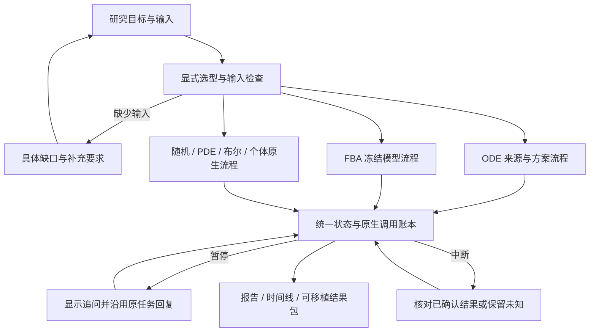

# 统一科研任务入口与六类续接

2026-10-30。当前交付把六类已有科学工作流接入同一套任务入口：记录目标、显式选择类型、检查所需输入、分派执行、展示状态、暂停回复、受控恢复、报告与导出。共享任务生命周期，各类型继续使用自己的模型与计算后端。

后续已接通[模型类型建议、输入草稿与有限来源布尔模型](task-proposals.md)：可选建议服务保留依据与未知项，由研究者显式选择；其余原生类型仍需准备模型。当前未实现任意论文到六类模型的自动构建、图形工作台或跨类型耦合。`goal` 是描述性任务标签，实际可执行范围由选定工作流决定；不会因输入一段研究问题就自动扩大工具能力。



## 类型与输入

| model_type | 统一入口的实际工作流 | 必需输入 |
|---|---|---|
| ode | 读取来源 → 原生 submit_plan → 校验/修复/澄清 → 模拟 → 完成检查 | source_refs、execution.experiment |
| fba | 已准备稳态模型的 FBA v2 Agent 执行与续接 | fba-import 返回的 model_ref；execution.settings 可选 |
| stochastic / pde / boolean / individual | 冻结原生模型和设置的 typed v2 Agent 执行与续接 | typed-import 返回的对应 model_ref；execution.settings 可选 |

四类原生模型的科学范围仍见[类型说明](model-types.md)，ODE 决策方案范围见[原生方案](native-modeling-decisions.md)。它们不能相互冒充或隐式转换。native 路径暂不解释 source_refs/modeling_context，需先准备原生模型。

配置 schema_version 必须为整数 1，goal 为 1–4000 字符。model_type 可暂为 null；默认 max_calls=6、context_max_chars=60000；可选 proposal_max_calls 为整数 0–3，默认 0，独立约束建议请求。拒绝未知字段、重复 JSON 字段、非有限数值和超限输入。ODE execution 支持 experiment、solver、observations、reference、scales；参考和固定尺度必须成对给出。原生 execution 仅含 settings，其内容由类型后端检查。

本地界面已可通过[研究工作台](research-workbench.md)操作这些流程；以下 CLI 保持可用。

## 从问题开始

先创建 `question.json`：

```json
{"schema_version":1,"goal":"运行并检查提供的布尔反馈网络。","model_type":null}
```

```bash
.venv/bin/python -m biomodel_agent research-task-capabilities
.venv/bin/python -m biomodel_agent research-task-create --config question.json --store runs/research
.venv/bin/python -m biomodel_agent research-task-show REQUEST_REF --store runs/research
```

尚未选择类型时显示 awaiting_type。配置虽可保存，但输入不全或不合法时显示 awaiting_input，逐项指出需补充的字段，不调用 provider 或计算后端。

导入已准备的模型：

```bash
.venv/bin/python -m biomodel_agent typed-import examples/model-types/boolean.json --store runs/research
```

把返回引用写进 `selected.json`：

```json
{
  "schema_version":1,
  "goal":"运行并检查提供的布尔反馈网络。",
  "model_type":"boolean",
  "model_ref":"MODEL_REF",
  "execution":{"settings":{"steps":8,"seed":123,"timeout_s":15.0}},
  "max_calls":6
}
```

```bash
.venv/bin/python -m biomodel_agent research-task-create --config selected.json --parent-ref REQUEST_REF --reason '明确选择已提供的布尔模型。' --store runs/research
.venv/bin/python -m biomodel_agent research-task-show SELECTED_REQUEST_REF --store runs/research
```

ready_to_run 表示当前输入满足该工作流的前置要求，不代表科学正确性已经验证。ODE 仍需在 Agent 提案后检查来源、方程、变量和参考列。

## 执行、回复和恢复

配置自己的模型服务与凭证环境变量后运行；下面的 run/resume/recover 可能实际调用服务：

```bash
.venv/bin/python -m biomodel_agent research-task-run SELECTED_REQUEST_REF --store runs/research --base-url https://YOUR_PROVIDER/v1 --model YOUR_MODEL
.venv/bin/python -m biomodel_agent research-task-show SELECTED_REQUEST_REF --store runs/research
.venv/bin/python -m biomodel_agent research-task-resume SELECTED_REQUEST_REF --reply-file reply.txt --respondent '研究者' --store runs/research --base-url https://YOUR_PROVIDER/v1
.venv/bin/python -m biomodel_agent research-task-recover SELECTED_REQUEST_REF --store runs/research --base-url https://YOUR_PROVIDER/v1
```

统一入口显式开启 FBA v2 / typed v2，ODE 使用原生方案主线。回复沿用原 native_task、模型输入、设置、种子及累计预算；原生类型的回复是执行澄清，不能改模型。ODE 的来源澄清仍走已有来源/方案修订流程。typed v2 的旧暂停点一旦续接，就不能再开启另一个分支；中断后应检查原执行并恢复。

同一个本地任务 family 最多分派一个 native Agent task。分派前可保存最多 16 次输入修订；一旦有预留，所有同 family 的修订都不能再次分派，亦不能通过删除 SQLite 索引重置。不同 revision 可以在分派前并存，分派后其他版本明确指向已选版本。新建独立 family 是明确的新任务，不是跨项目全局限额。

重复 run 已有结果的任务返回当前已确认结果，不调用模型或重复计算。外层结果写入中断时，可从已绑定的 native final 认领；native 内部中断由原调用账本审计和恢复。没有确认返回的外部/科学效果阻止重试。任务锁用于当前本地 store，不构成跨 store 的全局账本。

## 状态与产物

- awaiting_type / awaiting_input / ready_to_run：选型或输入准备阶段。
- awaiting_input 且带 native_run_ref：Agent 正在追问；pending_question 直接展示当前问题。
- needs_recovery：展示原 execution_ref、recovery_status/recovery_reasons 和已消耗调用/运行次数；blocked 不会自动发起重试。
- completed / incomplete：使用已保存的原生结果；技术完成与 scientific_support=unknown 分开。
- another_revision_dispatched：同 family 已由另一个输入版本分派。
- unknown_effects：预留后缺少足够绑定或结果，保留未知并阻断新执行。

```bash
.venv/bin/python -m biomodel_agent research-task-result RESULT_REF --store runs/research
.venv/bin/python -m biomodel_agent report RESULT_REF --output runs/report.md --store runs/research
.venv/bin/python -m biomodel_agent agent-timeline RESULT_REF --output runs/timeline.md --store runs/research
.venv/bin/python -m biomodel_agent export RESULT_REF --output runs/bundle --store runs/research
```

research_task_run 导出包含输入修订链、分派/绑定、原生任务和运行依赖。导出包中的命令只读取保存结果，不重放 Agent 推理或自动重算。仅导出尚未执行的 request 不会带入后来写入的结果；要交付结果请导出 RESULT_REF。

CLI create 输入尚不齐时返回 2；run/resume/recover 未完成或暂停时返回 2；非法输入/被阻断返回 1。show/result 返回 0 只表示成功读取，不代表科学通过。创建和状态查询不要求模型凭证。

## 兼容与验证

旧 ODE/FBA/typed 命令保持现有入口。直接 `agent-typed` 默认仍为旧版，新增 `--recoverable` 才启用 typed v2；统一任务入口默认使用可续接模式。旧记录不升级或补造检查点。输入、执行与恢复继续绑定源码/环境指纹，代码变化时不回签历史结果。

专项覆盖服务异常可读但不重试、六类分派、缺输入、错误类型、暂停回复、确认结果认领、未知效果、旧暂停点复用、任务所有权、版本与预算、索引删除、结果归属、报告和导出。公共 CLI 演练得到 7 次实际科学应用调用、16 次脚本响应和六类报告字节一致；不含线上模型调用或独立领域审核。最终完整回归 **2387 项通过**；本轮新增 **62 项**，最终定向 **75 项通过**，均零失败/错误/跳过。详见[本轮验收](../artifacts/unified-task-flow-20261029/README.md)。

```bash
.venv/bin/python -m pytest tests/test_research_tasks.py tests/test_typed_recovery.py -q
.venv/bin/python benchmarks/development/demo_research_tasks.py --output runs/unified-demo
```

下一阶段是让 Agent 提出可检查的类型建议与输入草稿、逐步补来源到原生模型的构建，并提供简单工作台。已有统一状态、缺口和续接接口可供它们复用；科研效果需要独立验证。
