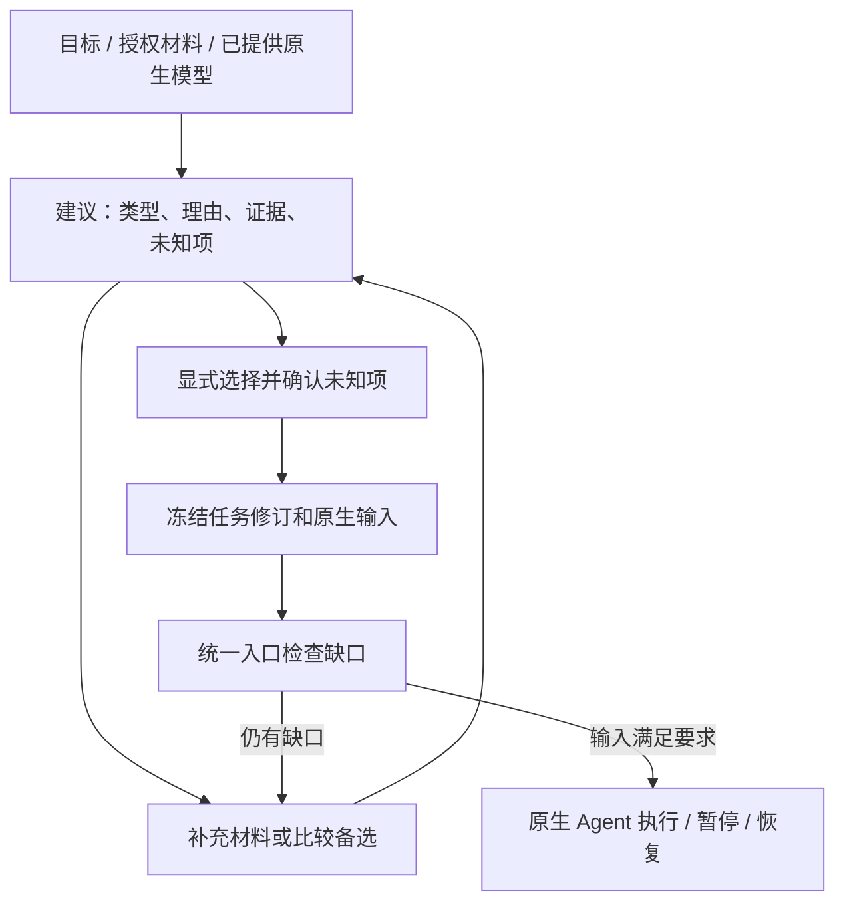

# 模型类型建议、输入草稿与来源模型

2026-10-30。本阶段在[统一任务入口](research-tasks.md)前增加可检查的建议层。它覆盖已有六类有限工作流，保存选型理由、原文引用、备选、所需输入、未知项与问题；研究者显式选择后生成任务修订，随后才可执行。建议本身不运行科学工具，也不证明某种模型适合真实生物学问题。



已接入[本地研究工作台](research-workbench.md)，可直接在浏览器里核对原文、查看候选和显式采纳。

## 实际范围

- 六类 `ode / fba / stochastic / pde / boolean / individual` 均能保存建议、给出对应输入清单与部分任务配置。配置只复制已有兼容输入，不凭空补速率、边界、反应、方程或参考数据。切换已有明确类型时不沿用另一类型的执行设置；被移除的输入会在 `input_notes` 中说明，其原引用仍在来源闭包中。
- 证据分为研究目标、授权来源切片、已提供模型引用。目标只说明意图；模型引用只说明输入结构。引用须精确匹配原文，重复文字需给出 `start/end`，不能指向授权范围外的材料。
- 新增来源构建包括 **1–16 节点、无钳制的显式布尔声明**，以及 [1–8 物质、1–16 反应的显式 SSA 声明](source-stochastic.md)。逐项检查原文与完整授权范围；不从自然语言推断规则、反应或常数。原生后端继续支持自己的范围。
- 默认建议调用预算为零；只有显式 `proposal_max_calls` 才能调用服务。已有 `max_calls` 继续约束原生执行。本地工作台已接入；通用论文理解、跨类型耦合或自主科研适用性审核尚未实现。

## 建议的来源与调用

可先用本地/外部已准备的建议 JSON，不调用产品 provider：

```bash
.venv/bin/python -m biomodel_agent research-proposal-create REQUEST_REF --config proposal.json --store runs/research
.venv/bin/python -m biomodel_agent research-proposal-show PROPOSAL_REF --store runs/research
.venv/bin/python -m biomodel_agent report PROPOSAL_REF --output proposal-report.md --store runs/research
```

这种建议标为 `operator_supplied`；产品内建议调用数为零，外部准备过程的 token 消耗为 `unknown`，不能按零计算。

若希望服务提出建议，在任务配置中显式写入 `"proposal_max_calls":1`（整数 0–3，默认 0），然后调用：

```bash
.venv/bin/python -m biomodel_agent research-task-propose REQUEST_REF --store runs/research --base-url https://YOUR_PROVIDER/v1 --model YOUR_MODEL
```

凭证沿用 `BIOMODEL_API_KEY` 或 `--api-key-env` 指定的变量。每条显式 propose 命令只请求一次，不自动重试、不自动修复响应，也不执行响应中声称要调用的科学动作。提供给服务的是目标、已有模型的有限结构摘要、已有执行配置，以及每来源前两页、每页前 1600 字符的摘录；截断和遗漏页有标记。并非全篇阅读，也没有建议阶段自主检索循环。消息必须符合既有 `context_max_chars`，否则在预留/发送之前报错。

本轮开发和演练使用脚本响应，**没有新增线上模型实验**。之前 USTC 先导授权仍只对应原先三个合成案例，不能据此发送本阶段新材料。

## 显式选择

```bash
.venv/bin/python -m biomodel_agent research-proposal-select PROPOSAL_REF --candidate CANDIDATE_ID --reviewer '研究者' --reason '说明此次选择依据' --store runs/research
```

候选有 `unknowns` 时，须用 `--acknowledged-unknowns-file unknowns.json` 提供与该列表完全一致、顺序一致的 JSON 数组。这表示研究者知悉未知项，不表示未知项已解决或完成领域审核。即使 recommendation 为 null，也允许研究者显式选一个备选；程序不会自动选择。

选择结果是同 family 的新 `research_task` 修订。输入仍不全会返回 `awaiting_input`，后续可以通过已有 task-create 修订补齐。来源检查通过的完整布尔或 SSA 草稿会在选择时生成带建议/审核来源的 `typed_model`，此时仍没有科学计算。随后使用：

```bash
.venv/bin/python -m biomodel_agent research-task-show SELECTED_REQUEST_REF --store runs/research
.venv/bin/python -m biomodel_agent research-task-run SELECTED_REQUEST_REF --store runs/research --base-url https://YOUR_PROVIDER/v1 --model YOUR_MODEL
```

建议保存为 proposed 或选择后输入完整时返回 0；需要补信息、等待选择或保存了无效建议返回 2；拒绝操作返回 1。proposed 只表示已保存推荐候选，草稿能否采纳仍须查看 draft_check。`research-proposal-show` 返回 0 仅表示成功读到记录，资格仍须查看 JSON 内 state/draft_check。

## 布尔来源声明

完整模板位于 [examples/task-proposals](../examples/task-proposals/README.md)。支持的文本形如：

```text
Initial A = False.
Initial B = False.
Rule A = not B.
Rule B = A.
Update = synchronous.
Time unit = sweep.
Clamps = none.
```

草稿须为每个节点初值、每条规则、更新方式、时间单位与无钳制声明给出完整行引用。规则以现有 Boolean 后端的闭合 AST 语法检查；空白/括号差异可等价，不执行任意 Python。

采纳前检查**整个授权来源范围**，不限于引用或发给服务的前缀：识别到的不同值/规则、额外节点、条件化声明、缺声明或缺映射都会阻断。为明确完整性边界，目前采纳只接受与原始 blob 匹配的 UTF-8 文本快照，总计最多 64000 字符；PDF、JATS 等须先准备经过研究者核对的转录。这个检查只针对声明语法，不理解所有自然语言矛盾，也不推断生物学规则。

## 预算、故障和导出

`research-task-show` 同时给出 `proposal_call_count / proposal_max_calls / native_call_count / total_call_count / max_total_calls`。旧 `call_count` 仍指原生调用，以保留生命周期兼容性。第一次建议预留后，同 family 的任务修订不能调整两类调用上限；删除 SQLite 索引也不能清空消费记录。一个 family 仍最多分派一个原生 Agent 任务。

建议请求先保存不可变 attempt，再发送；返回先保存 receipt，再做结构检查。错误响应也消耗一个建议额度，不能自动再发。无 usage 的调用记录为缺失，总 token 保持 unknown；已报告 token 与缺失调用数分别列出。

进程在预留后中断且没有已确认返回时，状态是 `needs_proposal_recovery`，阻断新的建议请求和原生分派。只认领已保存的返回：

```bash
.venv/bin/python -m biomodel_agent research-proposal-recover ATTEMPT_REF --store runs/research
```

若返回已保存、建议对象尚未写入，也用同一命令完成认领。需要查预留引用时，可通过 Python 的只读接口调用 `task_proposals.budget(store, research_tasks.load(store, REQUEST_REF)['family_id'])`，其 `attempt_refs/return_refs/unresolved_attempt_refs` 来自对象文件扫描。不存在返回时不会为了“恢复”重新请求服务。

选择后的任务与最终结果导出包含该 family 当时的建议、失败建议、预留及返回记录。初始 intake 是不可变快照，单独导出它不会自动包含后来新建的记录。建议本身也可 `export PROPOSAL_REF`，导出指令只读检查，不重新推理或计算。

本地 family 账本不是跨 store 全局限额。实现指纹改变时不能把旧建议重新认证为当前有效；历史产物应使用对应安装包读取/续接或显式重新准备。

## 证据与后续

开发验收见 [task-proposals-20261030](validation/20261030/README.md#前序增量)。六类输入草稿已有工程控制，新增来源布尔路径有实际后端计算、冲突拒绝和缺输入演练。它们都是已见合成开发材料，不代表真实模型的选型、构建成功率或科研正确率。后续 [SSA 来源构建](source-stochastic.md)已接入；对应记录见[SSA 验收](validation/20261030/README.md)。下一步进行真实资料端到端试用与效果验证。
