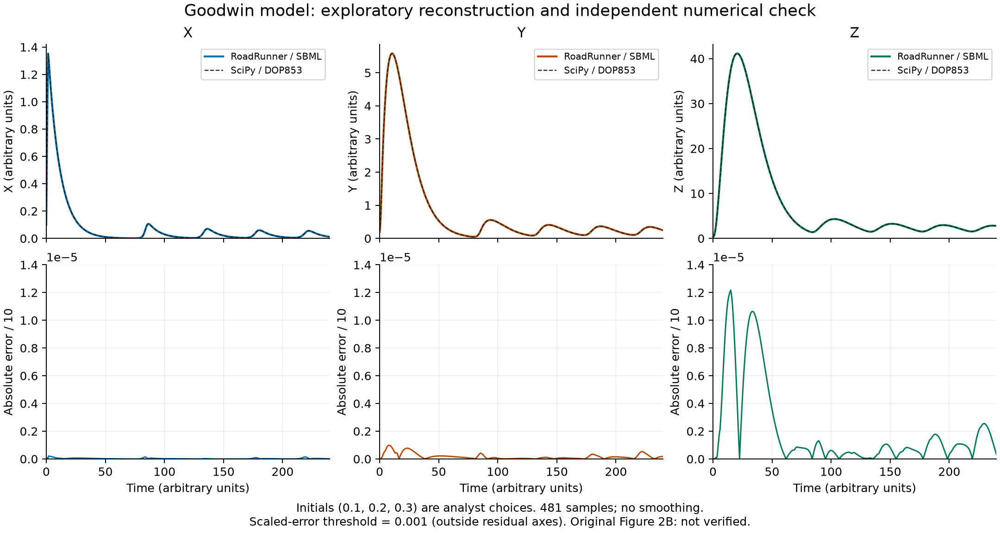

# Goodwin 示例

从已有文献工具流程演示中保留的 SBML 模型、实验协议、独立数值参考（SciPy 求解结果，不是作者原始数据）与轨迹图。参数基于 Gonze & Abou-Jaoudé (2013)；初值属于分析者选择，严格论文复现仍为 `not_verified`。

在仓库根目录运行：

```bash
.venv/bin/python -m biomodel_agent run examples/goodwin/model.xml --experiment examples/goodwin/experiment.json --reference examples/goodwin/reference.json --store runs/goodwin
```

此命令使用现有模型执行数值比较，不调用 LLM，不代表自动论文提取。



完整过程、失败记录与研究包见[原始演示](https://github.com/riveruning/Biomodeling/tree/5627aa0a382c6f4d3970119a1249c0650173327d/artifacts/literature-workflow-demo-20261021-normalized)。

新增 [Figure 2B 原图参考](figure2-reference/README.md)及[R10 定量诊断说明](../../docs/paper-reference.md)，单独报告图像特征，保留初值与独立审核缺口。
